# 🎓 Generador de Exámenes con Agentes de IA — Documentación Técnica

> **Proyecto:** MVP_v1 — Generador de exámenes en LaTeX propulsado por agentes de IA
> **Tesis:** USFQ
> **Fecha de documentación:** 2026-08-11 · **Última actualización:** 2026-10-19 (etapas 0-8, Tag V1.0.0)

Repo de referencia con material de estudio: https://github.com/tobiager/UNNE-LSI/tree/main

---

## 📋 Tabla de contenidos

1. [Visión general](#-visión-general)
2. [Glosario (términos técnicos)](#-glosario-términos-técnicos)
3. [Arquitectura de infraestructura](#-arquitectura-de-infraestructura)
4. [Pipeline de agentes (LangGraph)](#-pipeline-de-agentes-langgraph)
5. [Proceso completo del generador (paso a paso)](#-proceso-completo-del-generador-paso-a-paso)
6. [Los agentes en detalle](#-los-agentes-en-detalle)
7. [Flujo de datos y estado](#-flujo-de-datos-y-estado)
8. [Esquemas de datos](#-esquemas-de-datos)
9. [Configuración del LLM local](#-configuración-del-llm-local)
10. [Base de datos y migraciones](#-base-de-datos-y-migraciones)
11. [Renderizado LaTeX](#-renderizado-latex)
12. [Estado del proyecto](#-estado-del-proyecto)
13. [Arquitectura del monorepo (aplicada)](#-arquitectura-del-monorepo-aplicada)
14. [Agente conversacional (frontend propio + human-in-the-loop)](#-agente-conversacional-frontend-propio--human-in-the-loop)
15. [Cómo ejecutar](#-cómo-ejecutar)

---

## 🧭 Visión general

Este proyecto construye un **pipeline multi-agente** que genera exámenes universitarios completos en LaTeX a partir del **syllabus/material de una materia**. El sistema:

1. **Ingiere** los materiales del profesor (PDFs, textos, presentaciones, hojas de cálculo).
2. **Planifica** la estructura del examen (distribución por nivel de Bloom, dificultad y temas).
3. **Genera** ítems de examen uno por uno con un LLM.
4. **Evalúa** cada ítem (calidad, dificultad, duplicación) y lo aprueba o rechaza.
5. **Ensambla** los ítems aprobados en un documento LaTeX.
6. **Compila** el LaTeX a PDF mediante un microservicio.

Todo orquestado por **LangGraph**, con un estado compartido que viaja entre nodos y registros de auditoría (`rejection_log`, `compilation_log`, `total_llm_calls`).

Sobre el pipeline batch vive una **capa conversacional**: un agente asistente de cátedra con tools (listar/recuperar/generar/guardar preguntas, armar exámenes, indexar material) con **human-in-the-loop**, expuesto por `exam-app` (FastAPI) vía SSE/WS/REST y consumido por un **frontend propio (Vue 3)** con widgets reactivos y i18n en/es. El contrato del sistema (enums, tools, prompts, API) está en **inglés**; la UI es bilingüe.

---

## 📖 Glosario (términos técnicos)

Antes de entrar en detalle, conviene aclarar algunos términos que aparecen a lo largo de esta documentación. Son conceptos clave del proyecto (y de tu tesis):

### 🎯 Blueprint (plano / plan maestro)
Del inglés "blueprint" = **plano o diseño**. En este proyecto, un `ExamBlueprint` es el **"plano" del examen**: define *cuántas* preguntas tendrá, *cómo se reparten* por nivel de dificultad, por tema y por nivel cognitivo. Es la **receta** que dice "este examen debe tener X preguntas fáciles de 'recordar' sobre el tema Y, Z preguntas difíciles de 'analizar' sobre el tema W", etc.

> **Analogía:** si el examen fuera una pizza, el blueprint es la receta que dice cuánta masa, cuánto queso y cuántos ingredientes de cada tipo usar.

### 🌱 Niveles de Bloom (taxonomía de Bloom)
La **Taxonomía de Bloom** es una clasificación de los **niveles de pensamiento** que una pregunta puede exigir al estudiante. Va de lo más simple (memorizar) a lo más complejo (crear):

| Nivel (contrato) | Qué exige al estudiante | Ejemplo de pregunta |
|---|---|---|
| 🧠 **Recordar** (`remember`) | Memorizar y recordar datos | "¿Qué es el estudio de mercado?" |
| 📖 **Comprender** (`understand`) | Explicar con sus palabras | "Explica por qué es importante el estudio de mercado" |
| 🛠 **Aplicar** (`apply`) | Usar el conocimiento en una situación | "Calcula el punto de equilibrio con estos datos" |
| 🔍 **Analizar** (`analyze`) | Descomponer y relacionar | "Compara los flujos financieros de dos proyectos" |
| ⚖️ **Evaluar** (`evaluate`) | Juzgar y argumentar | "Evalúa si el proyecto es viable y justifica" |
| 💡 **Crear** (`create`) | Diseñar algo nuevo | "Diseña un plan de negocios para un emprendimiento" |

El pipeline usa estos niveles para **asegurar que el examen tenga un balance cognitivo** (no solo memorización).

### 🎚 Dificultad (`Difficulty`)
Nivel de complejidad percibida de la pregunta: `easy`, `medium`, `hard` (contrato en inglés desde la etapa 7). Se distribuye según el blueprint.

### 📝 Ítem / pregunta (`ItemSpec` y `GeneratedItem`)
- **`ItemSpec`** ("spec" = especificación): la **ranura** que el Planificador asigna. Dice exactamente *qué* hay que generar: tema, nivel de Bloom, dificultad y tipo de pregunta.
- **`GeneratedItem`**: el **resultado concreto** que el Generador produce: el enunciado, las opciones, la respuesta esperada y la solución.

### 🔁 Ítem / Slots (ranuras)
En este diseño, el examen se construye llenando "ranuras" (slots). Cada `ItemSpec` es una ranura que el Generador debe llenar con una pregunta concreta.

### 🤖 Agente
En este contexto, un "agente" es una **función del grafo** (no un agente autónomo complejo). Cada uno hace una tarea específica del pipeline. La "orquestación" entre ellos la hace LangGraph.

### 🧠 LLM / modelo de razonamiento
**LLM** = Large Language Model (modelo de lenguaje grande). Aquí usas **GLM-5.3-Flash** servido localmente con **vLLM**. Es un "modelo de razonamiento": puede "pensar" (generar un razonamiento interno) antes de responder. El parámetro `reasoning_effort` controla cuánto "piensa".

### 🗂 Syllabus
El **programa o temario** de la materia: la lista de temas, subtemas y su importancia relativa. Es la "materia prima" que el sistema usa como contexto para generar preguntas relevantes.

### 🔍 Deduplicación
Proceso de detectar si una pregunta generada es **demasiado similar** a otra ya aprobada, para evitar preguntas repetidas en el examen.

---

## 🏗 Arquitectura de infraestructura

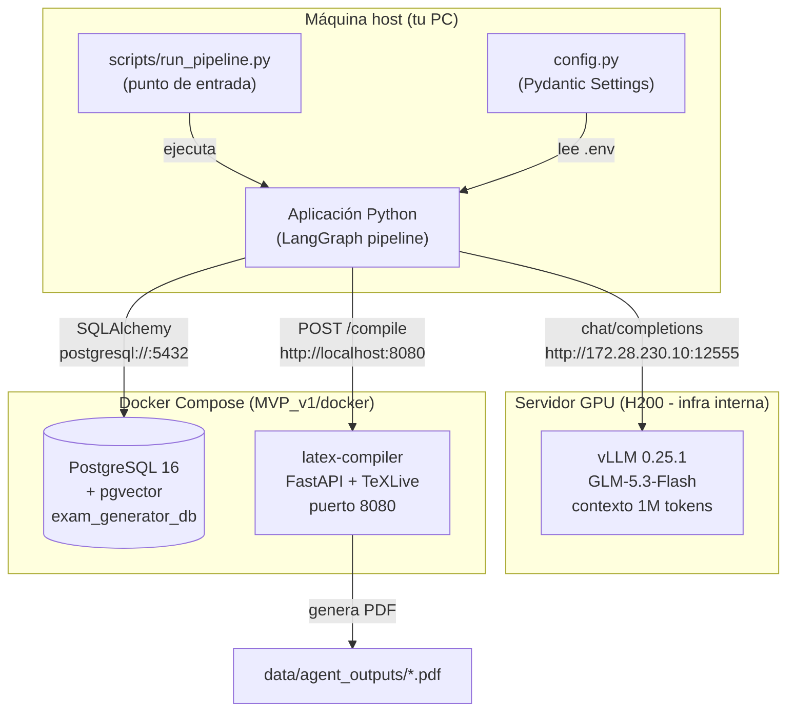

### Componentes y puertos

| Componente | Tecnología | Ubicación | Puerto |
|---|---|---|---|
| **Aplicación principal** | Python + LangGraph | `MVP_v1/` | — |
| **API** | FastAPI | `main.py` | `8000` |
| **LLM local** | vLLM + GLM-5.3-Flash | `172.28.230.10` | `12555` |
| **Base de datos** | PostgreSQL 16 + pgvector | Docker (`postgres-db`) | `5432` |
| **Compilador LaTeX** | FastAPI + TeXLive | Docker (`latex-compiler`) | `8080` |
| **Servicio de embeddings** | FastAPI + sentence-transformers (bge-m3) | Docker (`embedding-service`) | `8081` |

---

## 🧠 RAG (Retrieval-Augmented Generation)

El sistema usa **RAG** para que el LLM no tenga que leer todo el material cada vez. En lugar de eso, el material se **indexa una vez** (con embeddings) en la BD, y al generar cada pregunta se **recuperan solo los fragmentos relevantes**.

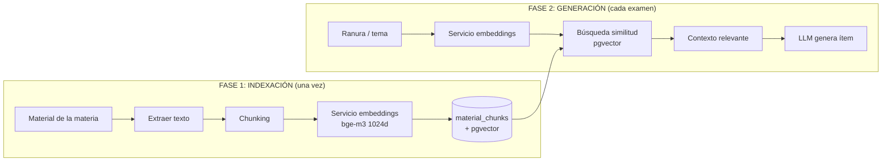

### Fase 1 — Indexación
- `scripts/index_material.py` o `POST /subjects/{id}/index` leen el material, lo dividen en chunks y generan embeddings.
- Los chunks + embeddings se guardan en `material_chunks` (con pgvector `vector(1024)`).

### Fase 2 — Generación con RAG
- El `generator_node` consulta `retrieve_chunks()` con el tema de la ranura.
- Recupera los `top_k` fragmentos más relevantes (similitud coseno) y se los pasa al LLM como contexto.
- Configurable vía `blueprint.retrieval` (`top_k`, `min_score`, `use_rag`).

### 💾 Persistencia
- Los ítems aprobados se guardan en `generated_questions` con sus embeddings (`persist_generated_items`).
- Esto crea un dataset de preguntas para experimentación y deduplicación futura.

---

## 🔀 Pipeline de agentes (LangGraph)

El corazón del sistema es un **grafo de estado** (`StateGraph`) donde cada nodo es un agente/función y las aristas son condicionales.

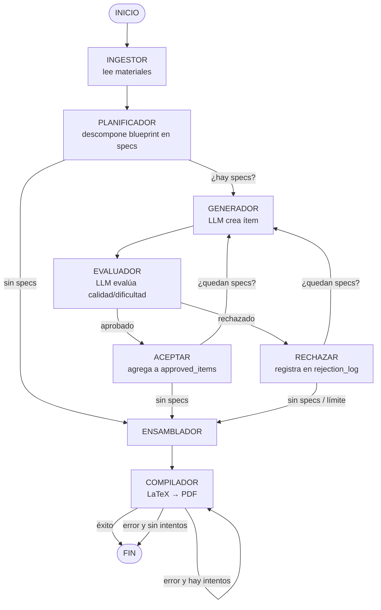

### Condicionales del grafo

| Condicional | Función | Decide |
|---|---|---|
| `after_evaluation` | ¿El ítem fue aprobado? | `accepted` / `rejected` |
| `should_continue` | ¿Quedan specs por generar? | `continue` / `assemble` |
| `should_retry_compilation` | ¿Reintentar compilación? | `retry` / `end` |

---

## 🔄 Proceso completo del generador (paso a paso)

Para que quede claro cómo funciona todo el sistema de principio a fin, aquí está el recorrido completo con un ejemplo concreto. Imagina que quieres generar un examen de **Economía Aplicada** con 8 preguntas.

### Paso 1 — Entrada de datos
El profesor sube sus materiales (PDFs, presentaciones, guías). En nuestro caso, la materia de prueba está en `data/inputs/Economia_Aplicada/` (35 archivos: apuntes, filminas, parciales, práctica).

### Paso 2 — Ingestor / Indexación: extraer el conocimiento
El **Ingestor** lee todos esos archivos (PDF, DOCX, PPTX, XLSX, texto) y extrae el texto. Con **RAG**, este material se **indexa una vez**: se divide en chunks (~2000 caracteres), se generan embeddings (bge-m3, 1024 dims) y se guardan en `material_chunks`. Así, en vez de releer todo cada vez, el sistema puede **recuperar solo los fragmentos relevantes** para cada pregunta.

### Paso 3 — Planificador: diseñar el examen (blueprint)
Definimos el **blueprint**: 8 preguntas, repartidas así:
- **Bloom**: 25% remember, 25% understand, 25% apply, 25% analyze → 2 de cada.
- **Dificultad**: 40% easy, 40% medium, 20% hard.
- **Temas**: 30% estudio de mercado, 30% flujos financieros, 25% análisis económico, 15% precios.

El Planificador convierte esta "receta" en **8 ranuras concretas** (`ItemSpec`), cada una especificando exactamente qué generar. Por ejemplo:
> "Ranura #1: tema 'Estudio de Mercado', nivel 'remember', dificultad 'easy', tipo 'multiple_choice'."

Este paso es **programático** (no usa el LLM): es determinista y barato.

### Paso 4 — Generador: crear cada pregunta (bucle)
El sistema entra en un **bucle**: toma una ranura a la vez y le pide al LLM que genere la pregunta correspondiente.

```
for cada ranura pendiente:
    1. Generador: LLM crea la pregunta (GeneratedItem) según la ranura
    2. Evaluador: LLM evalúa si es buena, si la dificultad coincide,
       y si no es duplicada de otra ya aprobada
    3. ¿Aprobada? → se agrega a "approved_items" y se pasa a la siguiente ranura
    4. ¿Rechazada? → se reintenta (hasta 3 veces) o se abandona la ranura
```

> 💡 **Detalle clave:** el Generador usa `with_structured_output` para que el LLM devuelva **JSON estricto** con el formato `GeneratedItem`. El LLM **nunca escribe LaTeX** — solo produce datos estructurados (enunciado, opciones, respuesta). El LaTeX se genera después, programáticamente.

### Paso 5 — Ensamblador: armar el documento
Cuando ya no quedan ranuras, el **Ensamblador** junta todos los ítems aprobados, los ordena y genera el **código LaTeX** del examen completo (portada, tabla de calificación, preguntas, soluciones).

### Paso 6 — Compilador: generar el PDF
El **Compilador** envía el LaTeX al microservicio `latex-compiler` (Docker), que ejecuta `pdflatex` **dos veces** (necesario para resolver totales de puntos y referencias) y devuelve el **PDF final** en `data/agent_outputs/`.

### Resultado
El sistema entrega un **examen PDF completo**, listo para imprimir, junto con un resumen JSON de todo el proceso (ítems aprobados, rechazos, llamadas al LLM, etc.).

---


## 🤖 Los agentes en detalle

Cada agente es una función pura que recibe el estado y devuelve un dict parcial que LangGraph mezcla con el estado global.

### 1. INGESTOR — `ingestor_node`
**Función:** leer los materiales crudos del profesor y producir un resumen del syllabus.

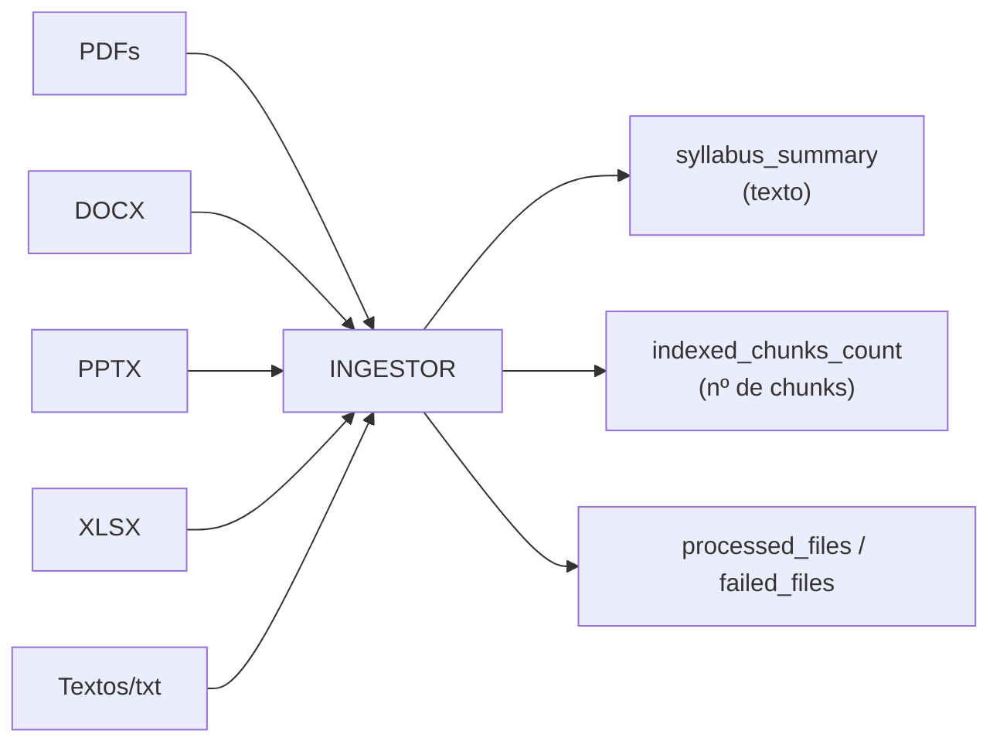

- Lee **PDFs** con PyMuPDF, **DOCX** con python-docx, **PPTX** con python-pptx, **XLSX** con openpyxl, y archivos de texto plano.
- Hace un **chunking heurístico** (~1 chunk por cada 2000 caracteres).
- **No llama al LLM** en el MVP (el indexado vectorial completo es una fase posterior).
- Reporta qué archivos procesó (`processed_files`) y cuáles fallaron (`failed_files`).
- Salidas: `syllabus_summary`, `indexed_chunks_count`, `processed_files`, `failed_files`.

> 💡 En la prueba real con la materia "Economía Aplicada", el ingestor procesó los 34 archivos (PDF, DOCX, PPTX, XLSX) generando **465 chunks** sin ningún fallo.

---

### 2. PLANIFICADOR — `planner_node`
**Función:** descomponer el `ExamBlueprint` en una lista explícita de `ItemSpec` (ranuras).

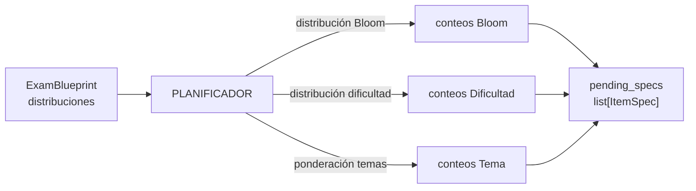

- **Determinista y programático** (no gasta llamadas al LLM): muestrea de las distribuciones.
- Cada `ItemSpec` especifica exactamente: tema, nivel de Bloom, dificultad, tipo de pregunta y puntaje.
- Salidas: `pending_specs` (cola de ranuras por generar).

---

### 3. GENERADOR — `generator_node`
**Función:** tomar el siguiente spec pendiente y generar un `GeneratedItem` con el LLM.

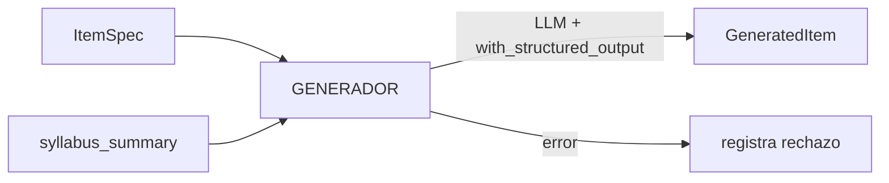

- Usa `generator_llm` con `reasoning_effort: none` (necesario para que el JSON salga en `content`, ver nota abajo).
- `with_structured_output(GeneratedItem)` fuerza el formato JSON estricto.
- Hace `pop(0)` del spec y lo pasa al evaluador.
- Salidas: `current_item`, `current_spec`, `pending_specs` (restante).

> ⚠️ **Nota importante (vLLM):** este modelo es de razonamiento. Si se usa `reasoning_effort > none` junto con `with_structured_output`, el modelo pone todo el output en el campo `reasoning` y deja `content` vacío → el JSON no se puede parsear → el ítem se rechaza. Por eso, tanto el Generador como el Evaluador usan `reasoning_effort: "none"` para que el JSON estructurado salga en `content`.

---

### 4. EVALUADOR — `evaluator_node`
**Función:** evaluar el ítem generado (calidad, dificultad, duplicación).

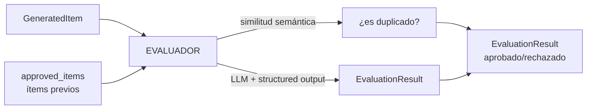

- **Chequeo de duplicación** contra ítems ya aprobados (solapamiento de tokens).
- **Evaluación de calidad** con `evaluator_llm` (`reasoning_effort: none`, temperatura baja).
- La duplicación **anula** cualquier aprobación.
- Salidas: `current_evaluation`.

---

### 5. ENSAMBLADOR — `assembler_node`
**Función:** armar el `CompiledExam` y generar el LaTeX final.

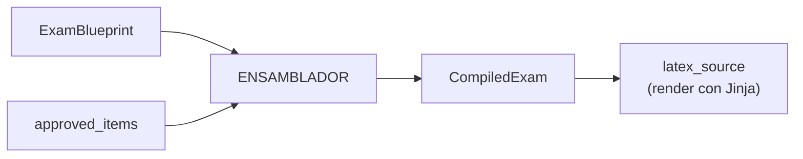

- Construye el `CompiledExam` con los ítems aprobados.
- Renderiza el LaTeX con `render_exam()` (Jinja + template `base_exam.tex.jinja`).
- Salidas: `compiled_exam`, `latex_source`.

---

### 6. COMPILADOR — `compiler_node`
**Función:** enviar el LaTeX al microservicio y guardar el PDF.

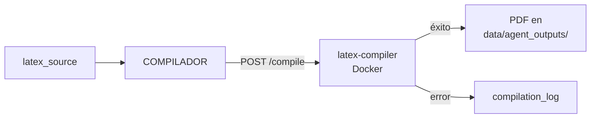

- Envía el LaTeX vía HTTP al microservicio (`requests`).
- El microservicio ejecuta `pdflatex` **dos veces** (necesario para resolver totales de puntos y referencias cruzadas de la clase `exam`).
- Reintenta hasta `max_compilation_attempts` (3).
- Guarda el PDF en `data/agent_outputs/`.
- Salidas: `compiled_exam.pdf_path`, `compilation_log`, `status`.

> ⚠️ **Nota técnica:** `pdflatex` debe ejecutarse 2 veces. En una sola pasada, deja avisos "Rerun to get point totals right" que hacen que el `returncode` sea distinto de 0 aunque el PDF se haya generado. Por eso el microservicio considera éxito si el PDF existe, independientemente del `returncode`.

---

## 📦 Flujo de datos y estado

El estado compartido (`ExamGenerationState`) viaja por todo el grafo. Se divide en secciones:

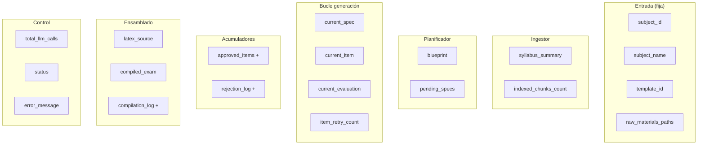

### Acumuladores con reducer `operator.add`

Los campos marcados con `+` usan el patrón estándar de LangGraph: cuando un nodo retorna un elemento nuevo, **se concatena** a la lista existente (no la sobreescribe). Esto permite que cada nodo del bucle solo maneje *su* ítem.

---

## 🧩 Esquemas de datos

Definidos en `projects/core/src/core/domain/schemas/exam.py`:

| Esquema | Descripción | Campos clave |
|---|---|---|
| `BloomLevel` | Enum de niveles de Bloom | `remember`, `understand`, `apply`, `analyze`, `evaluate`, `create` |
| `Difficulty` | Enum de dificultad | `easy`, `medium`, `hard` |
| `QuestionType` | Enum de tipos de pregunta | `multiple_choice`, `true_false`, `short_answer`, `essay`, `fill_in_blank`, `select_all` |
| `AnswerOption` | Opción de respuesta | `text`, `is_correct` |
| `GeneratedItem` | Contrato del LLM Generador | `topic`, `bloom_level`, `difficulty`, `question_type`, `statement`, `options`, `expected_answer`, `solution_explanation`, `points` |
| `EvaluationResult` | Salida del Evaluador | `approved`, `quality_score`, `difficulty_match`, `is_duplicate`, `similarity_score`, `rejection_reason` |
| `ExamBlueprint` | Estructura del examen | `total_questions`, `bloom_distribution`, `difficulty_distribution`, `topics_weight`, `estimated_duration_minutes` |
| `ItemSpec` | Ranura específica del Planificador | `topic`, `bloom_level`, `difficulty`, `question_type`, `points` |
| `CompiledExam` | Resultado final | `items`, `latex_source`, `pdf_path` |

> **Clave de diseño:** el LLM Generador **nunca genera LaTeX directamente** — solo produce la estructura `GeneratedItem`. El LaTeX se genera programáticamente en el ensamblador. Esto evita errores de sintaxis LaTeX del modelo.

> **Contrato en inglés (etapa 7):** los valores de los enums viajan en inglés en toda la cadena core ↔ BD ↔ agents-backend ↔ exam-app ↔ frontend. La migración `d4e5f6a7b8c9` tradujo los valores ya persistidos. El frontend los muestra vía vue-i18n (etiquetas por idioma).

---

## ⚙️ Configuración del LLM local

Definida en `projects/core/src/core/config.py` y `projects/agents-backend/src/agents_backend/shared/llm.py`:

| Parámetro | Valor | Descripción |
|---|---|---|
| `llm_model` | `zai-org/GLM-5.3-Flash` | Modelo servido |
| `llm_base_url` | `http://172.28.230.10:12555/v1` | Endpoint vLLM |
| `llm_max_tokens` | `65536` | Salida máxima por llamada |
| `llm_temperature` | `0.7` | Temperatura del generador |
| `llm_temperature_evaluator` | `0.2` | Temperatura del evaluador (más determinista) |
| `llm_reasoning_generator` | `none` | Razonamiento del generador (para JSON válido) |
| `llm_reasoning_evaluator` | `none` | Razonamiento del evaluador (para JSON válido) |
| `max_context_chars` | `6000` | Contexto del syllabus inyectado |

> ⚠️ **Por qué `reasoning_effort: none`:** el servidor vLLM soporta 7 niveles de razonamiento (`none`, `minimal`, `low`, `medium`, `high`, `xhigh`, `max`). Pero al usar `with_structured_output` (JSON), cualquier nivel > `none` hace que el modelo ponga el razonamiento en el campo `reasoning` y deje `content` vacío, rompiendo el JSON. Por eso Generador y Evaluador usan `none`.

**El servidor vLLM** (0.25.1) soporta:
- **Contexto de 1M tokens** (`max_model_len: 1048576`)
- **Salida hasta ~100k+ tokens** (probado empíricamente)
- **7 niveles de `reasoning_effort`**: `none`, `minimal`, `low`, `medium`, `high`, `xhigh`, `max`
- **Structured output**: `json_object`, `json_schema`, `regex`, `grammar`

### Configuración de embeddings (RAG)

| Parámetro | Valor | Descripción |
|---|---|---|
| `embedding_model` | `BAAI/bge-m3` | Modelo de embeddings (open-source) |
| `embedding_dim` | `1024` | Dimensión del vector |
| `embedding_url` | `http://localhost:8081/v1/embeddings` | Servicio de embeddings (Docker) |

Los embeddings se generan en un **microservicio Docker** (`embedding-service`, puerto 8081) que sirve `BAAI/bge-m3` como endpoint OpenAI-compatible. El pipeline los usa para indexar el material (RAG) y para la deduplicación/persistencia.

---

## 🗄 Base de datos y migraciones

Modelos en `projects/core/src/core/infrastructure/db/` (SQLAlchemy + pgvector):

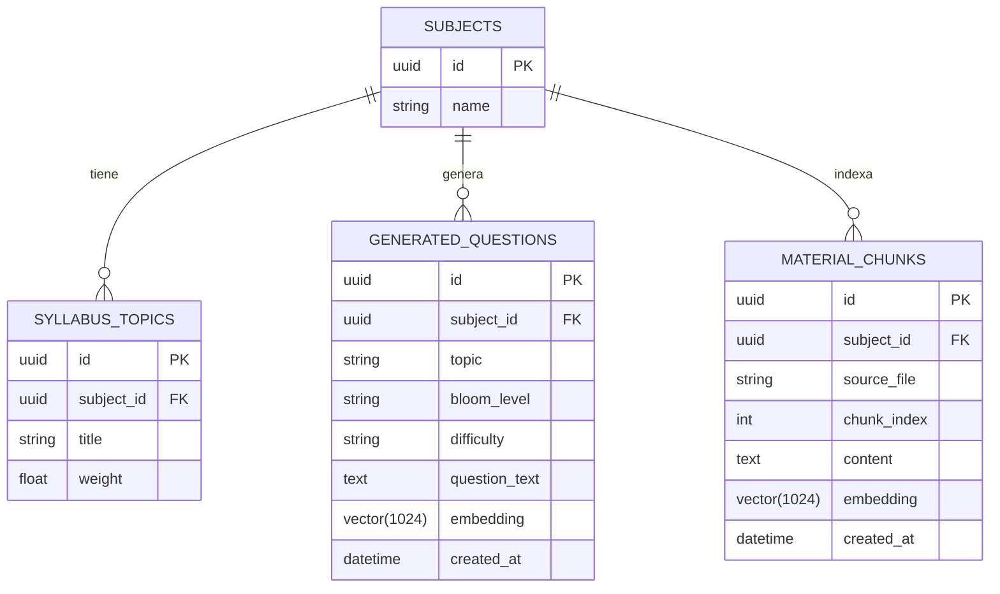

- **`Connection`**: `projects/core/src/core/infrastructure/db/connection.py` (engine + `SessionLocal`).
- **Migraciones**: Alembic en `projects/core/src/core/infrastructure/db/migrations/` (orquestadas por `alembic.ini` en la raíz). `env.py` inyecta la URL real desde `.env`.
- **pgvector**: las columnas `embedding` están tipadas como `vector(1024)` (modelo bge-m3).
- **Migración de contrato en inglés**: `d4e5f6a7b8c9` traduce los valores de enums ya persistidos (Bloom, dificultad, tipo, prioridad IA).

---

## 📄 Renderizado LaTeX

- **Templates**: `projects/core/src/core/infrastructure/latex/templates/base_exam.tex.jinja` (Jinja2) + `quiz_short.tex.jinja`.
- **Utilidades**: `projects/core/src/core/infrastructure/latex/utils.py` — `escape_latex()`, `render_item()`, `render_exam()`, `build_exam_versions()`.
- **Registry**: `projects/core/src/core/infrastructure/latex/templates/registry.py` — mapea `TemplateId` → archivo de template.
- **Nota técnica**: el entorno Jinja usa delimitadores de comentario `<#`/`#>` para evitar colisión con las macros LaTeX `{#1}`.
- **PDFs en inglés** (etapa 7): `\usepackage[english]{babel}`, "Page X of Y", "Name:", "Answer all questions in the space provided.", "Solution:".

---

## 🚦 Estado del proyecto

> **Etapas 0-8 completadas** (ver [implementaciones/](implementaciones/README.md) para el detalle por etapa). Release actual: **`Tag_V1.0.0`**.

### ✅ Implementado y validado

**Infraestructura y pipeline batch:**
- Infraestructura Docker (Postgres + pgvector + latex-compiler + embedding-service + exam-app + frontend)
- Configuración Pydantic + LLM local (vLLM + GLM-5.3-Flash)
- Pipeline end-to-end con materia real (Economía Aplicada): ingestor → planner → generator → evaluator → assembler → compiler
- **RAG completo**: indexación multi-formato (PDF, DOCX, PPTX, XLSX, TXT) + recuperación por similitud (pgvector)
- **Persistencia** de ítems generados en `generated_questions` (estructura completa + embeddings)
- **Blueprint enriquecido**: `retrieval` config y `metadata` para experimentación
- **Versiones anti-copia** (estilo AMC) con barajado de preguntas y opciones
- **PDFs en inglés**: templates LaTeX con `babel/english`, encabezados/pies/instrucciones en inglés

**Backend reactivo (etapa 2):**
- **SSE** `POST /api/chat/stream` con eventos versionados (`v:1`): `token`, `tool_start`, `tool_end`, `question_generated`, `questions_listed`, `artifact_ready`, `material_indexed`, `done`, `error`, `cancelled`
- **WebSocket** `/ws` como bus de eventos y cancelación
- **Adjuntos propios** `POST /api/files` (extraer → guardar → indexar)
- `PendingItemStore` por thread (reemplaza la global de módulo) sincronizado con el checkpointer
- `/v1/chat/completions` intacto (OpenWebUI legado)

**Arquitectura limpia (etapas 2b/2c):**
- `projects/` como monorepo de submódulos git: `core`, `agents-backend`, `exam-app`, `frontend`, `latex-compiler`, `embedding-service`
- Grafo acíclico `frontend → exam-app → agents-backend → core`; routers de exam-app sin imports de agents-backend/core
- Eventos tipados en `agents_backend/shared/events.py` (EventBus por thread) espejados en `exam_app/schemas/events.py` y `frontend/src/types/events.ts`

**Frontend propio (etapas 3-5):**
- Vue 3 + Vite + TS + Pinia, cliente SSE/WS con reconexión, gestión de `thread_id` (historial en localStorage)
- Widgets reactivos: `QuestionCard` (HITL), `QuestionsTable` (ordenar/filtrar/detalle), `ArtifactCard` (descarga PDF/CSV/XLSX), `MaterialToast`, `FileDrop`
- Pantallas: Materias, Banco de preguntas (verificación humana), Exámenes (blueprint + versiones), Material
- Guardrails respetados desde la UI: verificación humana vía `core.domain.bank.service`, `delete_question` bloqueado (HTTP 403) si está verificada

**Docker (etapa 6):**
- Frontend dockerizado (multi-stage node → nginx) con proxy único de `/api`, `/ws`, `/output`, `/v1` y rutas REST hacia exam-app (sin CORS)
- `env.js` generado en runtime por el entrypoint (`VITE_API_URL`/`VITE_WS_URL`)
- Healthchecks en compose; OpenWebUI movido al perfil `legacy` (puerto 3001)
- E2E validado en Docker: chat con tools, generación de examen vía proxy, PDF descargable

**Traducción e i18n (etapa 7):**
- **Contrato en inglés**: enums (`remember/understand/apply/analyze/evaluate/create`, `easy/medium/hard`, `multiple_choice/true_false/short_answer/essay/fill_in_blank/select_all`), tools renombradas, prompts (`SYSTEM_PROMPT` y pipeline) y mensajes de API
- **Migración Alembic** `d4e5f6a7b8c9` traduce los valores ya persistidos (BD local verificada)
- **vue-i18n** con catálogos `en`/`es`, locale persistido en `localStorage`; enums mostrados con valores del contrato
- LaTeX (babel english), compose, `.env.example` y scripts en inglés

**Auth multi-profesor + UX reactiva + CRUD completo (etapa 8, Tag V1.0.0):**
- **Autenticación JWT**: `POST /auth/register`, `POST /auth/login`, `GET /auth/me` (HS256, 12h, PBKDF2-SHA256 para passwords, secret vía `AUTH_SECRET`)
- **Multi-tenant**: tabla `users` + `subjects.owner_id` (migración `e5f6a7b8c9d0`); materias legacy (`owner_id NULL`) compartidas; scoping por profesor en materias, banco, material, exámenes y subida de archivos (403 si es ajena)
- **Frontend**: login/registro con sesión persistente, router guard, navbar superior con selector de materia reactivo (sidebar retirada), barra de contexto con contadores, indicador de contexto en el chat
- **Contexto bidireccional**: el selector actualiza chat/banco/material/exámenes; "selecciona la materia X" en el chat actualiza el selector (tool `select_subject` + evento `subject_selected`)
- **CRUD completo desde el chat**: `update_question_tool` y `delete_question_tool` (guardrail: preguntas verificadas por humano inmutables); el agente obtiene el `question_id` con `search_questions`
- **nginx**: `no-cache` en `index.html` (evita bundle obsoleto tras deploys)

### 🔬 Validado empíricamente (endpoint LLM)
- `max_tokens=100000` aceptado
- Contexto de 36k tokens procesado
- 7 niveles de `reasoning_effort`
- Structured output compatible (con `reasoning_effort: none`)

### 🐛 Bugs encontrados y corregidos
- **`reasoning_effort` + structured output**: con `reasoning_effort > none`, vLLM deja `content` vacío → JSON inválido → ítems rechazados. Corregido usando `none`.
- **Compilación de doble pasada**: `pdflatex` necesita 2 pasadas; el microservicio ahora ejecuta `pdflatex` dos veces y considera éxito si el PDF existe.
- **Embeddings**: `sentence-transformers` arrastra torch con CUDA → se instala `torch` CPU primero, luego `sentence-transformers` normal.

### ⏳ Pendiente
- Push a GitHub de los 7 repos (etapa 1: remotos + CI + pipeline de integración del meta-repo)
- Deduplicación con embeddings reales (hoy usa solapamiento de tokens)
- Deploy en servidor remoto (DGX) — bloqueado por decisión del proyecto hasta integrar los cambios
- Definir `AUTH_SECRET` en producción (el fallback de dev es inseguro por diseño)
- Asignar `owner_id` a las materias legacy si se quiere privacidad retroactiva

---

## 💬 Agente conversacional (frontend propio + human-in-the-loop)

### Arquitectura

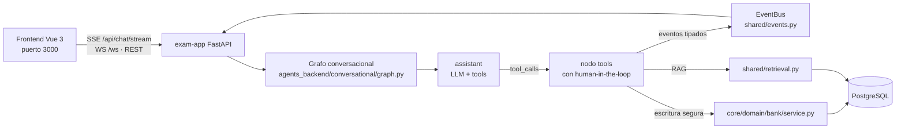

El frontend consume SSE (tokens + eventos tipados), WS (cancelación) y REST (materias, banco, exámenes, material). Los eventos tipados se renderizan como **widgets** en el chat (tarjeta de pregunta HITL, tabla interactiva, card de artefacto, toast de material). OpenWebUI queda como **interfaz legada opcional** (perfil `legacy`, `/v1/chat/completions`).

### Herramientas del agente (tools)

| Tool | Tipo | Descripción |
|---|---|---|
| `list_subjects` | Lectura | Lista las materias registradas (id + nombre) |
| `search_questions` | Lectura | Recupera preguntas del banco (no genera) |
| `generate_question` | Generación | Genera UNA pregunta con RAG (no guarda; deja el ítem pendiente) |
| `save_question` | **Escritura** | Guarda en el banco + verificación por IA |
| `save_pending_question` | **Escritura** | Persiste el ítem pendiente de `generate_question` |
| `confirm_human_verification` | **Escritura** | Marca `verified_by_human=True` |
| `update_question_tool` | **Escritura** | Actualiza campos de una pregunta (parcial; guardrail: verificadas por humano inmutables) |
| `delete_question_tool` | **Escritura** | Elimina una pregunta (guardrail: verificadas por humano no se borran) |
| `generate_exam_pdf` | **Escritura** | Genera examen, compila a PDF y lo adjunta al chat |
| `add_material_file` | **Escritura** | Indexa un archivo adjunto en la materia (RAG) |
| `list_subject_material` | Lectura | Lista los archivos y chunks indexados de una materia |
| `export_questions` | Lectura | Exporta el banco a CSV/XLSX y lo adjunta al chat |
| `register_subject` | **Escritura** | Registra una nueva materia |
| `select_subject` | Contexto | Marca la materia activa de la conversación (emite `subject_selected`; el selector del frontend reacciona) |

### Flujo con human-in-the-loop

```mermaid
graph TD
    U[Profesor: "give me 20 questions on these topics"] --> A[assistant]
    A -->|search_questions| B[Recupera del banco]
    A -->|generate_question| C[Genera UNA pregunta]
    C -->|muestra al profesor| D{¿Confirmas guardar?}
    D -->|sí| E[save_pending_question<br/>+ verificación IA]
    D -->|no| A
    E --> F{¿Confirmas verificación humana?}
    F -->|sí| G[confirm_human_verification<br/>verified_by_human=True]
    F -->|no| A
```

**Puntos de decisión humana** (a nivel de prompt, con `WRITE_TOOLS = {save_question, save_pending_question, confirm_human_verification}`):
1. Antes de **guardar** una pregunta.
2. Antes de marcar **verificación humana**.

El HITL se implementa **por prompt** (el agente pregunta y solo ejecuta las tools de escritura tras la confirmación explícita), no con `interrupt` nativo de LangGraph, porque el transporte SSE/WS no reanuda interrupciones.

### Restricciones de seguridad de escritura

- Toda escritura pasa por `core/domain/bank/service.py`.
- `update_question` / `delete_question` lanzan `SecurityError` si `verified_by_human=True` (aplica tanto a las tools del chat como a la API REST del Banco).
- `set_human_verification()` solo lo invoca la confirmación humana explícita del chat (o la vista Banco del frontend).

### Autenticación multi-profesor (etapa 8)

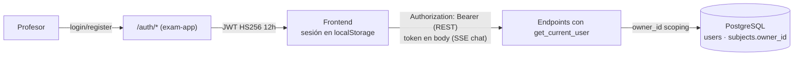

- **Modelo**: `users` (email único, name, password_hash PBKDF2-SHA256, role) y `subjects.owner_id` (nullable → NULL = materia legacy compartida, retrocompatible).
- **Endpoints**: `POST /auth/register` (409 duplicado), `POST /auth/login` (401 inválidas), `GET /auth/me`.
- **Scoping**: materias, banco, material, exámenes y `/api/files` filtran por `owner_id` (403 si la materia pertenece a otro profesor). El chat valida el token (en el **body**, porque el SSE POST del navegador no siempre puede mandar headers) y la propiedad de la materia del contexto.
- **Frontend**: sesión persistente en `localStorage` (token restaurado sincrónicamente al crear el store), router guard (todo excepto `/login` exige sesión), logout limpia stores.
- **Config**: `AUTH_SECRET` (obligatorio en producción; fallback de dev inseguro por diseño).

### Contexto reactivo de materia (bidireccional)

- **Selector → app**: cambiar la materia en el navbar actualiza los stores (`subjects`, `chat`) y refresca banco/material/exámenes; las vistas reaccionan por `watch(activeSubjectId)`.
- **Chat → selector**: la tool `select_subject` emite `subject_selected`; el `ChatPanel` sincroniza el selector y los paneles (y registra la materia si el agente la acaba de crear con `register_subject`, que emite `subject_registered`).
- **Contrato del evento en 3 capas** (deben cambiar juntas): `agents_backend/shared/events.py` → `exam_app/schemas/events.py` (Literal) → `frontend/src/types/events.ts`.

### Persistencia del contexto de conversación

El grafo usa un **checkpointer persistente** con `PostgresSaver` (PostgreSQL). Las conversaciones se retoman entre reinicios usando el `thread_id` (el frontend lo persiste en `localStorage` por conversación). Si no hay BD disponible, cae a `InMemorySaver` (efímero).

### Entrega de PDFs (adjunto en el chat)

Cuando el agente genera un examen (`generate_exam_pdf`):
1. Compila el LaTeX a PDF vía el microservicio `latex-compiler`.
2. Devuelve un enlace markdown `[Download PDF vN](http://<host>/output/{file}.pdf)` servido por exam-app y proxificado por el frontend (mismo origen).
3. Emite el evento tipado `artifact_ready` para que el frontend renderice la card de descarga.

---

## 🛠 Cómo ejecutar

```bash
# 1. Activar entorno
source .venv/Scripts/activate

# 2. Levantar infraestructura completa (Postgres + latex-compiler +
#    embedding-service + exam-app + frontend)
cd docker && docker compose up -d --build
#    OpenWebUI (legado, opcional):
cd docker && docker compose --profile legacy up -d

# 3. Migraciones (el contenedor exam-app las aplica al arrancar; también manual)
alembic upgrade head

# 4a. Indexar el material de una materia (RAG)
.venv/Scripts/python.exe scripts/index_material.py \
    --name "Economía Aplicada" \
    --materials "data/inputs/Economia_Aplicada/**/*.pdf"

# 4b. Ejecutar el pipeline completo (genera un PDF)
.venv/Scripts/python.exe scripts/run_pipeline.py

# 5. API de exam-app (http://localhost:8000)
#    --- Chat propio del frontend ---
#    POST /api/chat/stream        → chat SSE (tokens + eventos tipados)
#    POST /api/chat               → chat sin streaming
#    POST /api/files              → subir adjunto (extraer → indexar)
#    WS   /ws                     → bus de notificaciones y cancelación
#    --- Materias / banco / exámenes / material ---
#    GET  /subjects               → listar materias
#    POST /subjects               → registrar materia
#    GET  /subjects/{id}/questions → banco de preguntas (filtros)
#    PUT  /questions/{id}/verification → verificación humana (HITL)
#    GET  /subjects/{id}/exams    → historial de exámenes
#    GET  /subjects/{id}/material → material indexado
#    DELETE /subjects/{id}/material → eliminar material
#    POST /subjects/{id}/index    → indexar material (RAG)
#    POST /exams/generate         → generar examen (blueprint)
#    GET  /output/{filename}      → descargar PDF/CSV/XLSX generado
#    GET  /health                 → estado del servicio

# 6. Agente conversacional (OpenAI-compatible, legado)
#    GET  /v1/models               → listar modelos
#    POST /v1/chat/completions     → conversar con el agente
#    POST /v1/chat/completions     → reanudar confirmación humana (resume)

# 7. Frontend propio (http://localhost:3000) — chat + widgets + pantallas
#    OpenWebUI legado (http://localhost:3001) con perfil "legacy"
```

---

## 🏛 Arquitectura del monorepo (aplicada)

> La reestructuración descrita en [docs/arquitectura-objetivo.md](docs/arquitectura-objetivo.md) ya está **aplicada** (etapas 0-2c). El diseño completo sigue vigente como referencia.

El repositorio es un **monorepo de submódulos git**: cada app/lib vive en su propio repo (local; remotos GitHub pendientes) y el meta-repo fija qué commit de cada una compone cada versión del sistema.

```
MVP_v1/
├── projects/                # submódulos git (un repo por app/lib)
│   ├── frontend/            # Vue 3 + Vite + TS + Pinia + vue-i18n — chat embebido + pantallas
│   ├── exam-app/            # FastAPI — API pública/BFF: SSE chat, adjuntos, REST, WS bus
│   ├── agents-backend/      # LangGraph — exam_pipeline + conversational + shared (llm, RAG, events)
│   ├── latex-compiler/      # microservicio FastAPI + TeXLive
│   ├── embedding-service/   # microservicio FastAPI + sentence-transformers
│   └── core/                # shared kernel: modelos SQLAlchemy, banco (escritura segura),
│                            # schemas, migraciones Alembic, clientes de microservicios, config
├── data/ · docker/ · deploy/ · docs/ · scripts/
└── alembic.ini
```

Reglas clave (vigentes):

- **Dependencias hacia adentro**: `frontend → exam-app → agents-backend → core`. Ninguna capa importa "hacia arriba" (única excepción: el puente `openwebui_bridge`, reexportación sin lógica).
- **Arquitectura limpia por app**: dominio → aplicación → interface adapters → infraestructura. Los routers de exam-app nunca tocan LangGraph ni la BD directamente; pasan por `services/` y puertos en `domain/`.
- **Eventos tipados**: las tools del agente emiten eventos versionados (`question_generated`, `artifact_ready`, …) que exam-app reenvía por SSE y el frontend renderiza como widgets.
- **Control de versiones**: cada app/lib tiene su repo Git; el meta-repo fija los SHAs. Los remotos en GitHub y la CI por repo están pendientes (etapa 1).

