# Infrastructure graphs

This document is the visual source of truth for the MVP infrastructure. It uses
Mermaid because the repository already renders Mermaid diagrams in its technical
documentation and the diagrams can be reviewed without a separate modeling server.
The model is C4-like where useful, but the agent views use an
**Agent Harness Reference Model**. That model separates the agent runtime,
context/state providers, tool execution, approval policy, observability, and
evaluation evidence. This is more useful here than forcing every concern into
only context/container/component levels.

## Reading order

1. **Context**: actors, external systems, and trust boundaries.
2. **Containers**: deployable services and data stores.
3. **Agent components**: conversational and batch LangGraph contexts.
4. **Harnessing**: the primary view for reproducible agent experiments.
5. **Runtime flows**: the two production paths and their evidence outputs.

## Level 1 - system context

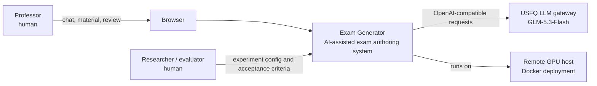

The system has two human-facing roles. The professor operates the product and
confirms question verification. The evaluator operates the experiment harness
and interprets evidence; it does not bypass the production guardrails.

## Level 2 - deployment and containers

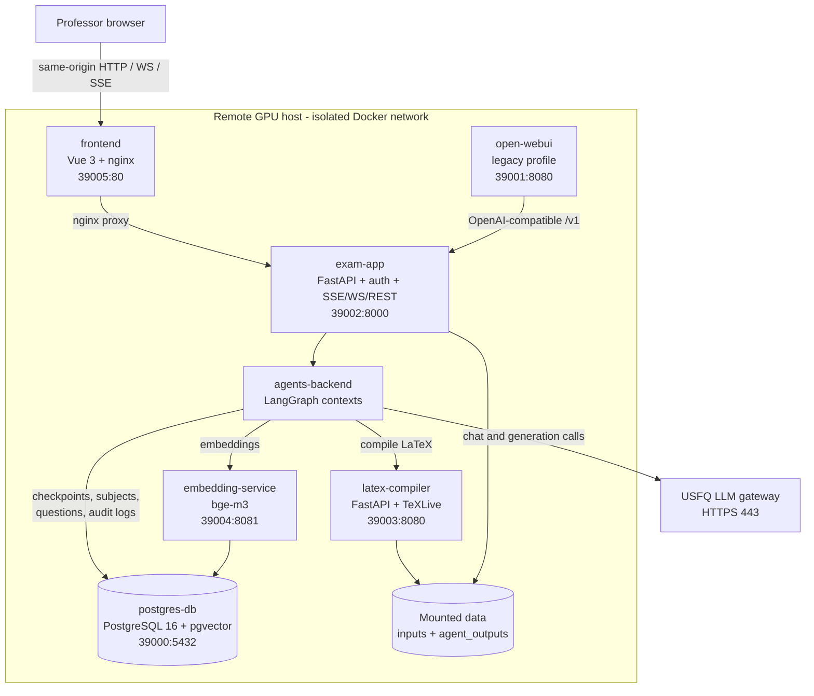

The local Compose profile uses ports 3000/8000/5432/8080/8081. The remote
deployment uses the high ports shown above and mounts data only below the
deployment user's home directory.

## Level 3 - agent contexts

### 3.1 Conversational context

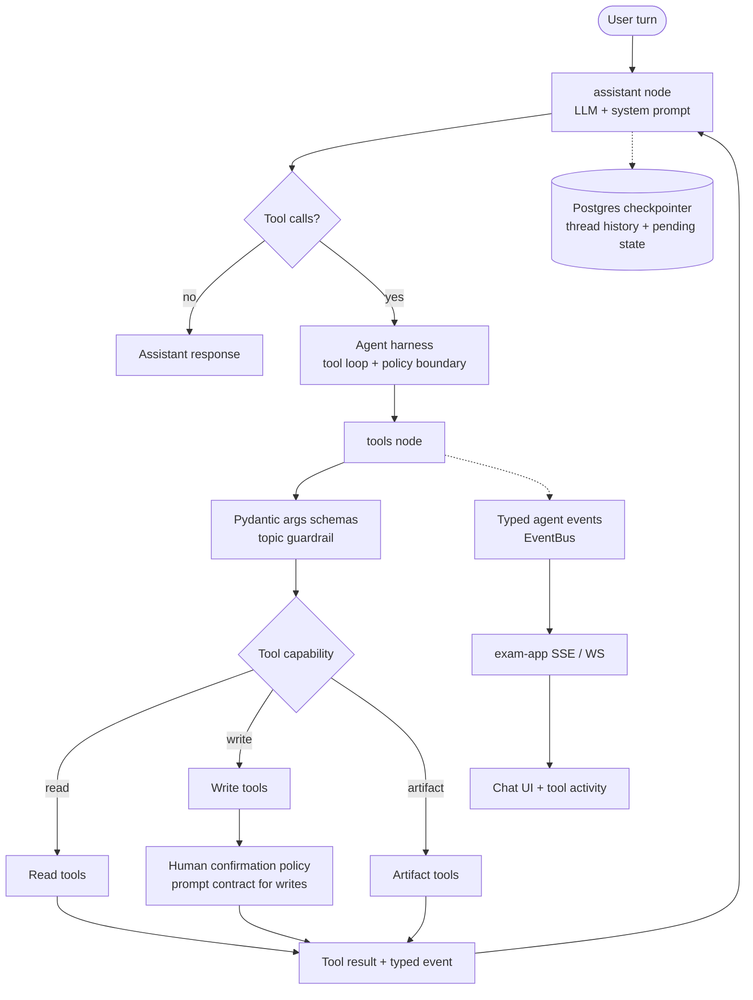

The conversational graph is a ReAct loop. The checkpointer preserves thread
state, while the event bus exposes tool activity without coupling the agent to
the Vue client. The harness boundary is the place where tool schemas, scope,
confirmation, result handling, and evidence must remain explicit.

### 3.1.1 Tool capability map

The tool registry is the agent's action surface. The grouping below is based on
the actual `TOOLS` list and `WRITE_TOOLS` set in
`projects/agents-backend/src/agents_backend/conversational/graph.py`.

```mermaid
flowchart TB
    model["LLM tool call<br/>name + typed args"] --> registry["TOOL_BY_NAME<br/>registry"]
    registry --> read["READ / inspect"]
    registry --> generate["GENERATE / propose"]
    registry --> write["WRITE / mutate"]
    registry --> material["MATERIAL / RAG"]
    registry --> subject["SUBJECT / context"]
    registry --> artifact["ARTIFACT / export"]

    read --> list_subjects["list_subjects"]
    read --> search_questions["search_questions"]
    read --> list_material["list_subject_material"]

    generate --> generate_question["generate_question<br/>one question per call"]
    generate --> generate_exam["generate_exam_pdf<br/>blueprint -> ZIP"]

    write --> save_question["save_question"]
    write --> save_pending["save_pending_question"]
    write --> verify["confirm_human_verification"]
    write --> update["update_question_tool"]
    write --> delete_question["delete_question_tool"]

    material --> add_material["add_material_file<br/>index + embeddings"]
    material --> delete_material["delete_material_file<br/>remove file + chunks"]

    subject --> register["register_subject"]
    subject --> select["select_subject<br/>frontend event"]

    artifact --> export["export_questions<br/>CSV / XLSX / JSON"]
```

Tool classes are not interchangeable. Read tools query existing state; generate
tools create a proposal or a package; write tools mutate durable state; material
tools change the RAG corpus; subject tools change the active context; artifact
tools create a downloadable result. This distinction is the basis for approval,
audit, and test coverage.

### 3.1.2 Tool invocation lifecycle

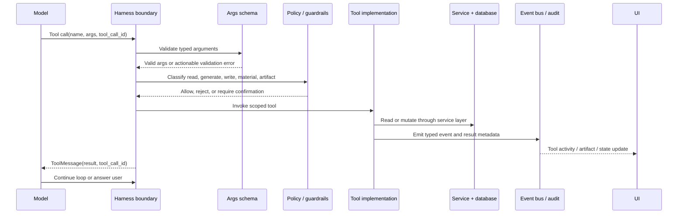

The current implementation performs confirmation at the prompt contract for
OpenWebUI compatibility, while the harness boundary remains the architectural
location of the policy. Validation failures become actionable `ToolMessage`
results; unknown tools and execution failures do not silently look successful.

### 3.2 Batch generation context

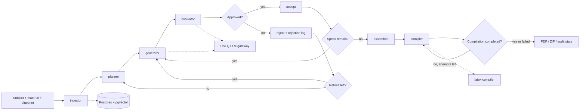

The batch context is stateful within a run. Rejections, retries, accepted
items, LLM call counts, and compilation attempts are explicit state fields and
must remain observable in the run record.

## Level 3 - infrastructure interfaces

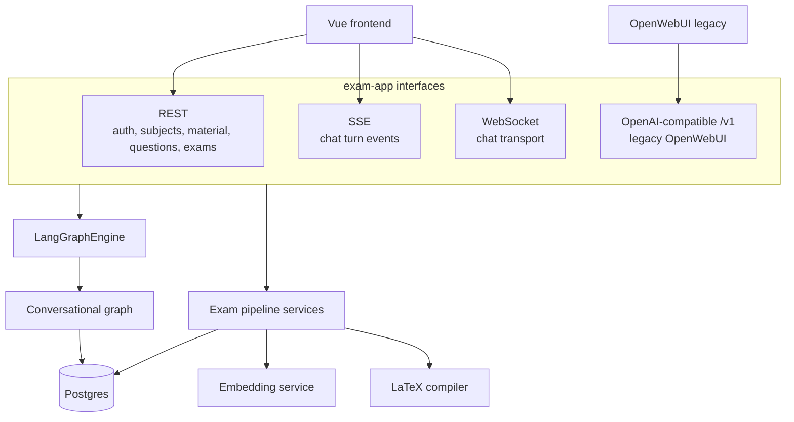

## Level 4 - primary graph: agent harnessing

This is the most important graph for the thesis. The harness is an executable
control plane around the agent, not another agent. It selects a profile,
controls the experimental arm, runs the same pipeline in dry or real mode,
captures telemetry, and emits evidence that can be audited after the run.

The design follows the Agent Harness Reference Model: runtime loop, context
providers, capability/tool providers, middleware/policy, UX/event streaming,
and an evaluation plane. Microsoft's Agent Harness documentation uses the same
separation for function invocation, session context, approvals, observability,
and bounded loops; this project maps those concepts to LangGraph, typed tools,
Postgres, EventBus, and the evaluation harness.

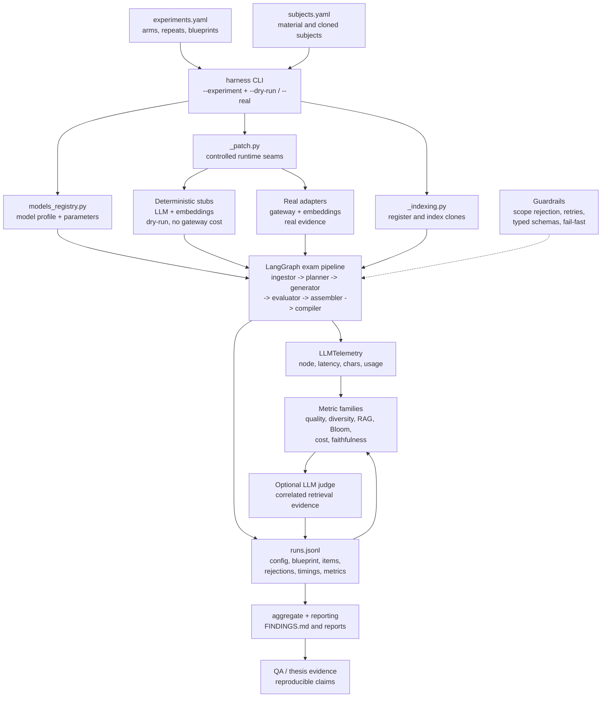

### 4.1 Agent harness planes

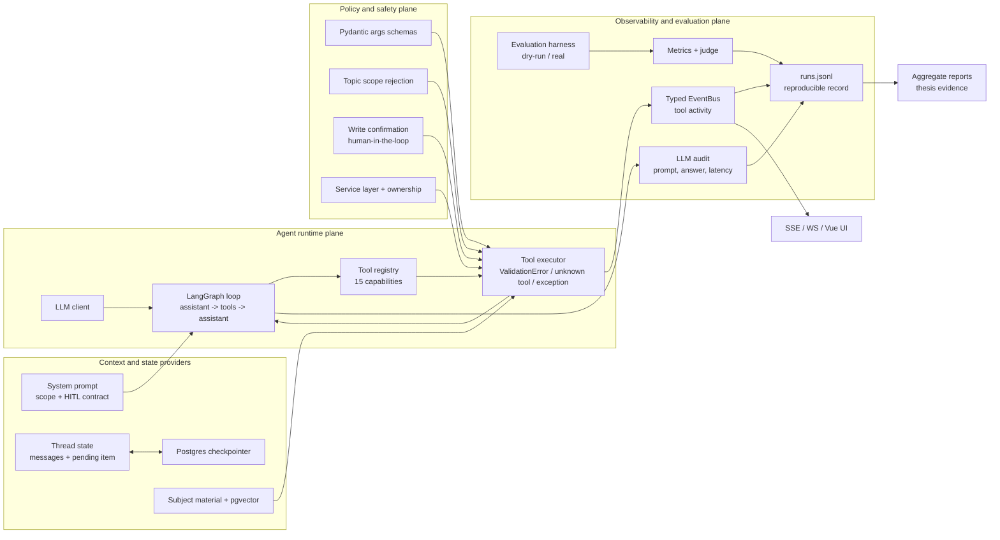

The critical boundary is between the runtime plane and the policy/evidence
planes. The model proposes actions, but schemas, scope rules, approval, service
ownership, event emission, audit capture, and evaluation determine what can be
done and what can be claimed.

### 4.1.1 Runtime layer - components

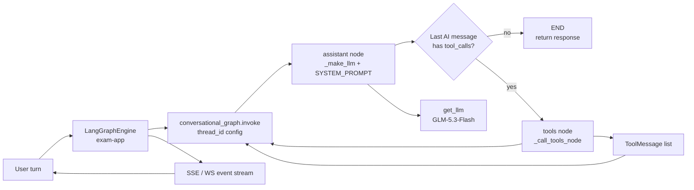

### 4.1.2 Context and state layer - components

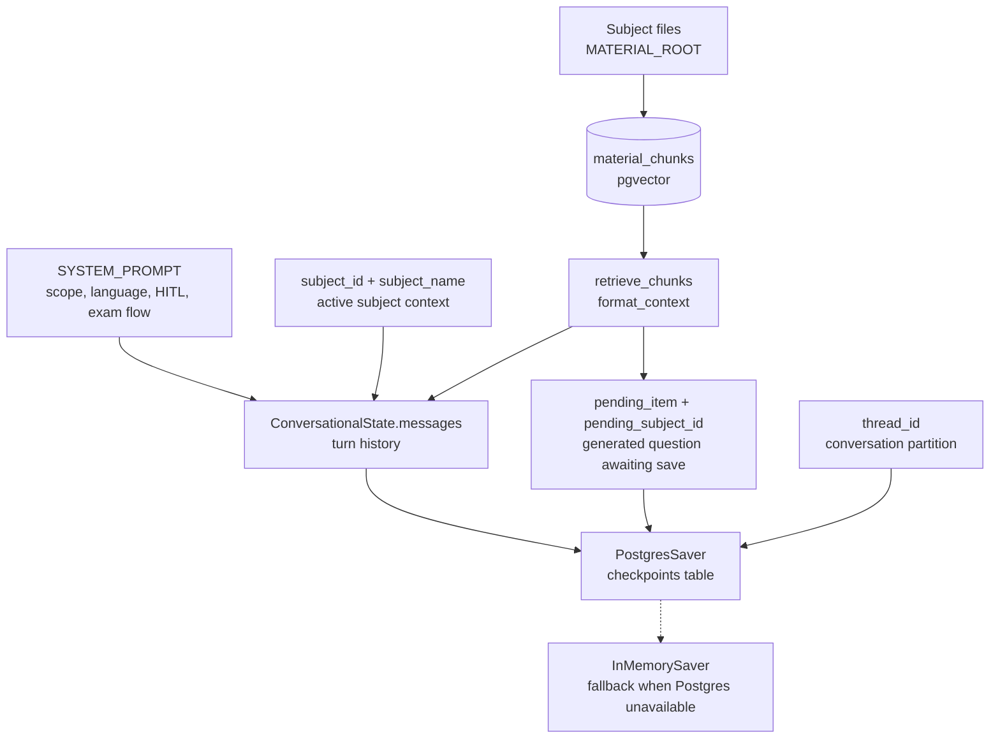

### 4.1.3 Tools layer - complete capability graph

This is the detailed action surface of the conversational agent. Every leaf is
an actual registered tool, and each branch shows its primary service or data
boundary.

```mermaid
flowchart TB
    call["LLM tool call<br/>name + JSON args"] --> registry["TOOLS list<br/>TOOL_BY_NAME"]
    registry --> read["READ BANK / SUBJECT"]
    registry --> question["QUESTION LIFECYCLE"]
    registry --> material["MATERIAL / RAG"]
    registry --> exam["EXAM / ARTIFACT"]
    registry --> context["SUBJECT CONTEXT"]

    read --> list_subjects["list_subjects"]
    read --> search["search_questions"]
    read --> list_material["list_subject_material"]
    list_subjects --> db_read[("Subject + question tables")]
    search --> bank_read["bank.list_questions"]
    list_material --> chunk_read["MaterialChunk count + source files"]

    question --> generate["generate_question"]
    question --> save["save_question"]
    question --> pending_save["save_pending_question"]
    question --> verify["confirm_human_verification"]
    question --> update["update_question_tool"]
    question --> delete["delete_question_tool"]
    generate --> rag["retrieve_chunks + generator_llm"]
    generate --> pending_store["pending_store<br/>thread-scoped proposal"]
    save --> bank_write["bank.create_question"]
    pending_save --> bank_write
    verify --> verify_write["bank.set_human_verification"]
    update --> update_write["bank.update_question"]
    delete --> delete_write["bank.delete_question"]
    bank_write --> db_write[("generated_questions")]
    verify_write --> db_write
    update_write --> db_write
    delete_write --> db_write

    material --> add["add_material_file"]
    material --> remove_material["delete_material_file_tool"]
    add --> extract["extract_file_text"]
    extract --> index["index_text_for_subject"]
    index --> embeddings["embedding service"]
    embeddings --> chunks[("material_chunks + embeddings")]
    remove_material --> material_guard["exact source_file + delete policy"]
    material_guard --> chunks
    material_guard --> files[("MATERIAL_ROOT files")]

    exam --> generate_exam["generate_exam_pdf"]
    exam --> export["export_questions"]
    generate_exam --> blueprint["ExamBlueprint + versions"]
    blueprint --> batch["exam pipeline + LaTeX compiler"]
    batch --> outputs[("PDF / ZIP output volume")]
    export --> export_service["bank export serializer"]
    export_service --> outputs

    context --> register["register_subject"]
    context --> select["select_subject"]
    register --> subject_write[("subjects")]
    select --> subject_event["SUBJECT_SELECTED event"]
```

### 4.1.4 Tool layer - guardrails, services, and outputs

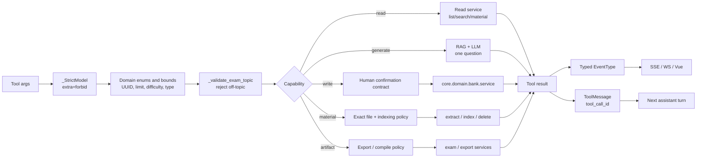

The distinction between the tool registry and the service layer is intentional:
the model can request a capability, but domain services enforce ownership,
verification restrictions, persistence, and material integrity.

### 4.1.5 Policy and safety layer - components

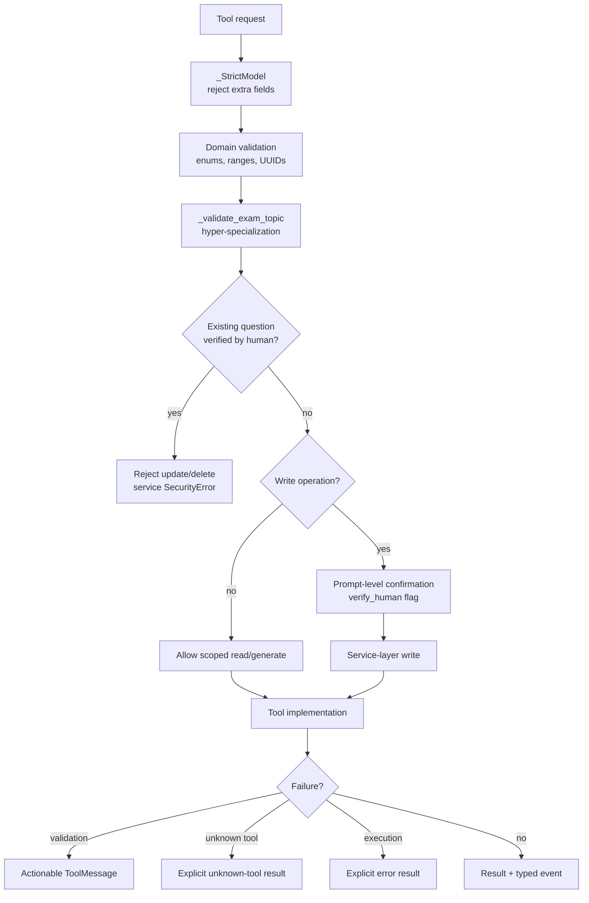

### 4.1.6 Observability and evaluation layer - components

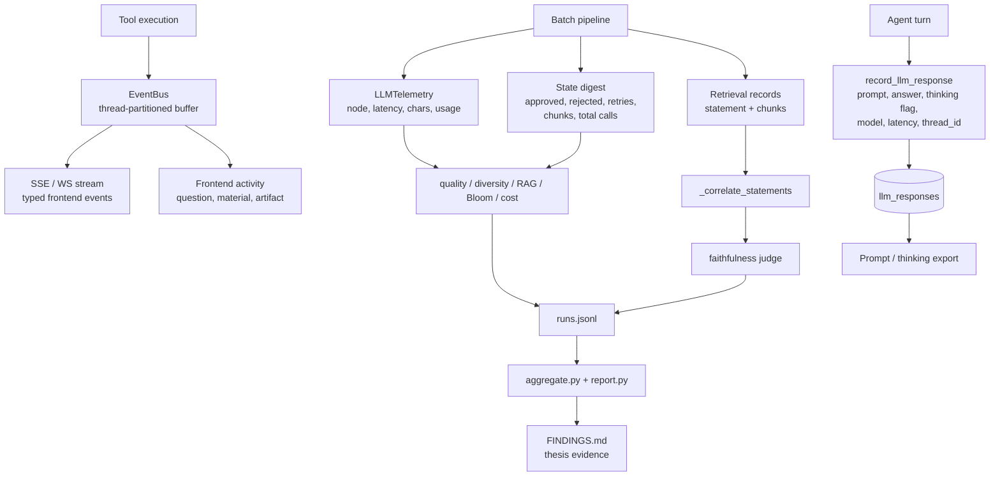

### 4.1.7 UX and transport layer - components

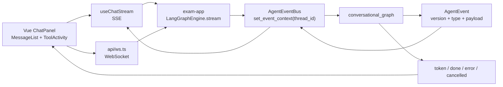

Each layer now has a corresponding component diagram. The tools layer is
deliberately split into capability, guardrail, service, persistence, and output
views so that a tool is not represented as an opaque box.

## 4.1.8 Sublayer map

The layers above describe responsibilities. These sublayer graphs describe the
internal sequence inside each responsibility. They are intentionally more
operational than C4: each sublayer names the contract, state, decision, side
effect, and feedback boundary.

### Runtime sublayers

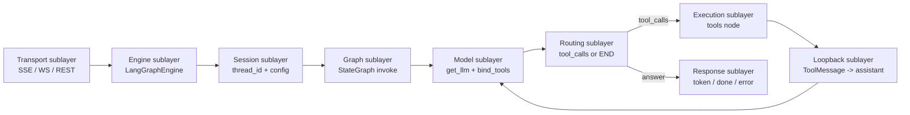

### Context sublayers

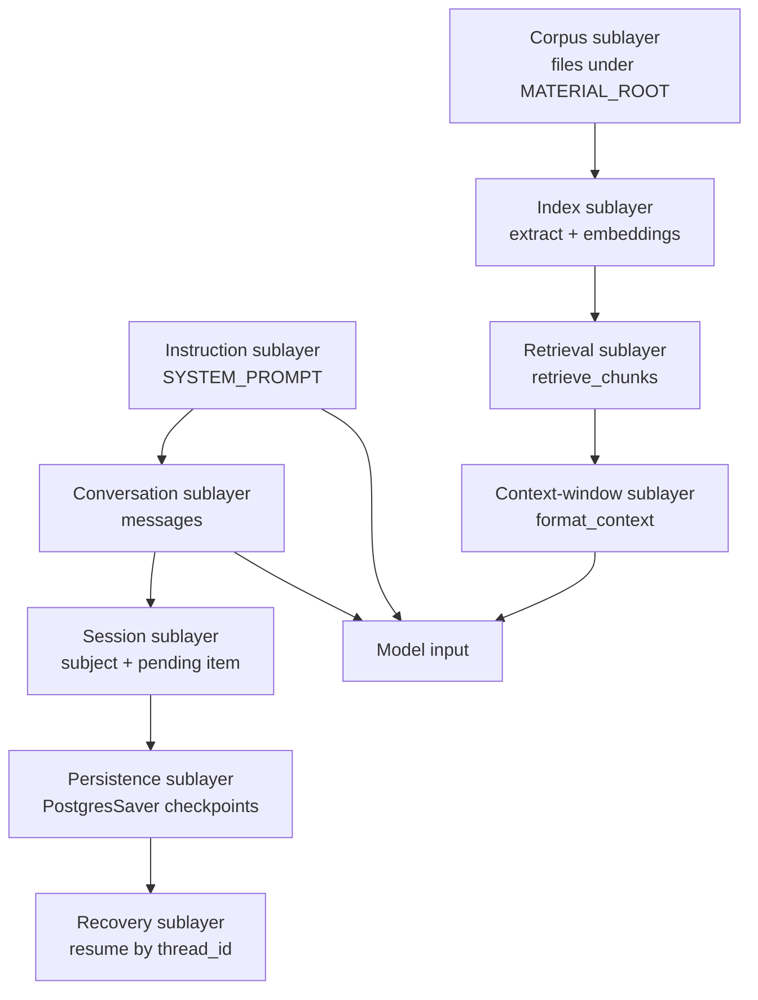

### Tools sublayers

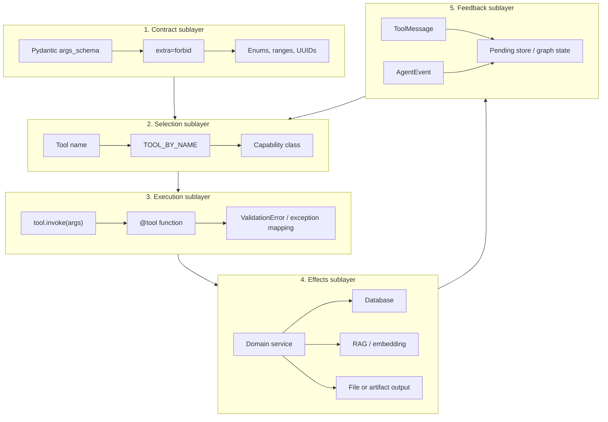

This is the tools layer's most important decomposition: a tool is not only a
Python function. It is a typed contract, a registry selection, a guarded
execution, an effect boundary, and a feedback message/event.

### Tool sublayers by capability

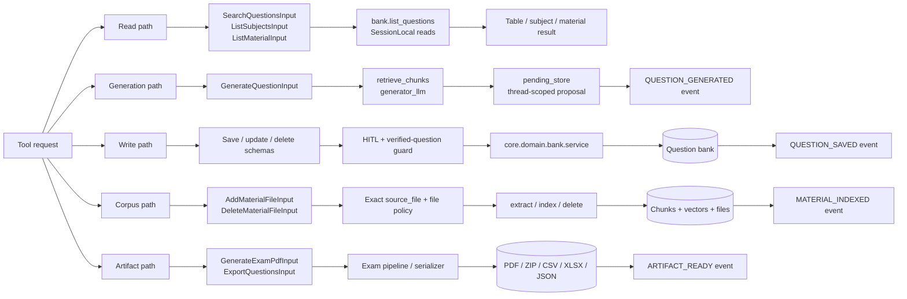

### Policy sublayers

```mermaid
flowchart TB
    input["Raw model arguments"] --> syntax["Syntax sublayer<br/>JSON + Pydantic"]
    syntax --> domain["Domain sublayer<br/>enums + value limits"]
    domain --> scope["Scope sublayer<br/>hyper-specialized topic guard"]
    scope --> ownership["Ownership sublayer<br/>subject / question access"]
    ownership --> integrity["Integrity sublayer<br/>verified question immutable"]
    integrity --> consent["Consent sublayer<br/>human confirmation"]
    consent --> transaction["Mutation sublayer<br/>service-layer write"]
    transaction --> result["Explicit result or error"]
```

### Observability sublayers

```mermaid
flowchart LR
    action["Model or tool action"] --> capture["Capture sublayer<br/>latency, prompt, answer, event"]
    capture --> correlation["Correlation sublayer<br/>thread_id, tool_call_id, run_id"]
    correlation --> transport["Transport sublayer<br/>EventBus, SSE, WS"]
    correlation --> storage["Storage sublayer<br/>llm_responses, runs.jsonl"]
    storage --> analysis["Analysis sublayer<br/>metrics, judge, aggregate"]
    transport --> ui["UX sublayer<br/>ToolActivity + artifacts"]
    analysis --> findings["Evidence sublayer<br/>reports + FINDINGS"]
```

### Evaluation harness sublayers

```mermaid
flowchart TB
    definition["Definition sublayer<br/>experiments.yaml + subjects.yaml"] --> profile["Profile sublayer<br/>models_registry"]
    profile --> adapter["Adapter sublayer<br/>_patch + stubs or real"]
    adapter --> setup["Fixture sublayer<br/>clone registration + indexing"]
    setup --> run["Execution sublayer<br/>same exam LangGraph"]
    run --> trace["Trace sublayer<br/>calls + state + retrieval"]
    trace --> score["Scoring sublayer<br/>quality, diversity, RAG, Bloom, cost"]
    trace --> judge["Judge sublayer<br/>correlated faithfulness"]
    score --> record["Record sublayer<br/>one runs.jsonl line"]
    judge --> record
    record --> report["Reporting sublayer<br/>aggregate + FINDINGS"]
```

### Sublayer evidence matrix

| Layer | Sublayers | Primary evidence |
|---|---|---|
| Runtime | transport, session, graph, model, routing, execution, response | `LangGraphEngine`, `conversational_graph`, `ToolMessage` |
| Context | instruction, conversation, session, persistence, corpus, retrieval | `SYSTEM_PROMPT`, `ConversationalState`, checkpointer, `retrieve_chunks` |
| Tools | contract, selection, execution, effects, feedback | `args_schema`, `TOOL_BY_NAME`, service calls, events |
| Policy | syntax, domain, scope, ownership, integrity, consent, mutation | `_StrictModel`, topic guard, `SecurityError`, HITL contract |
| Observability | capture, correlation, transport, storage, analysis, UX | `record_llm_response`, EventBus, `llm_responses`, `runs.jsonl` |
| Evaluation | definition, profile, adapter, fixture, execution, trace, score, judge, report | `harness.py`, `_patch.py`, metrics, `FINDINGS.md` |

### 4.2 Harness control loop and evidence checkpoints

```mermaid
flowchart TD
    input["Experiment definition<br/>arm, repeat, subject clone, blueprint"] --> setup["Setup checkpoint<br/>load profile + overrides"]
    setup --> mode{"Execution mode"}
    mode -->|"dry_run"| deterministic["Stub LLM + StubEmbedder<br/>deterministic, no gateway cost"]
    mode -->|"real"| external["Gateway + real embedder<br/>production-like behavior"]
    deterministic --> execute["Invoke same LangGraph pipeline"]
    external --> execute
    execute --> call_trace["Per-call trace<br/>node, latency, chars, usage"]
    execute --> state_trace["State digest<br/>approved, rejected, retries,<br/>chunks, total calls"]
    execute --> retrieval_trace["Retrieval trace<br/>chunks correlated to statement"]
    call_trace --> metrics["Metric computation"]
    state_trace --> metrics
    retrieval_trace --> judge["Faithfulness judge<br/>only with correlated pairs"]
    metrics --> record["Append complete runs.jsonl record"]
    judge --> record
    record --> report["Aggregate / report / FINDINGS"]
    report --> decision["Research decision<br/>claim, limitation, or next run"]
```

Each checkpoint answers a different audit question: what was configured, what
was executed, what the agent did, what evidence it saw, how it was scored, and
which conclusion is justified. A report without these checkpoints is not
reproducible harness evidence.

### Harness invariants

| Invariant | Implementation evidence |
|---|---|
| Same pipeline in dry and real modes | `test/evaluation/src/harness.py` invokes the production graph; `_patch.py` swaps controlled seams. |
| Every run is attributable | `runs.jsonl` stores experiment, arm, repeat, subject clone, blueprint, and timings. |
| Clone-based robustness | `subjects.yaml` and `ensure_subject()` index the same material under separate subject identities. |
| Guardrails are measured, not implied | Rejections, retry counts, evaluator results, and RAG evidence are persisted. |
| Production code stays testable | Stubs and monkey patches live under `test/evaluation`, not in agent runtime paths. |
| Judge evidence is correlated | Retrieval chunks must be paired with the originating statement before judging faithfulness. |

### Harness execution flow

```mermaid
sequenceDiagram
    participant E as Evaluator
    participant H as Harness
    participant R as Registry
    participant P as Patch layer
    participant G as LangGraph pipeline
    participant M as Metrics
    participant O as runs.jsonl

    E->>H: Select experiment, arm, mode
    H->>R: Load model profile and overrides
    H->>P: Install dry-run or real adapters
    H->>G: Register/index clone and invoke pipeline
    G-->>H: Items, rejections, calls, compilation result
    H->>M: Compute quality, RAG, Bloom, cost, diversity
    M->>O: Append one complete run record
    O-->>E: Reproducible evidence and report inputs
```

## Runtime flow - conversational generation

```mermaid
sequenceDiagram
    participant U as Professor
    participant F as Vue + nginx
    participant A as exam-app
    participant C as Conversational graph
    participant T as Tool layer
    participant L as LLM gateway
    participant D as Postgres

    U->>F: Chat request
    F->>A: SSE/WS/REST with thread_id
    A->>C: Invoke graph with persisted config
    C->>L: Prompt + tool schema
    L-->>C: Answer or tool call
    C->>T: Execute scoped tool
    T->>D: Read/write through service layer
    T-->>A: Typed event and tool result
    A-->>F: Activity, token, done/error
    F-->>U: Render response and artifacts
```

## Runtime flow - batch and evaluation

```mermaid
sequenceDiagram
    participant H as Harness or API
    participant P as Batch graph
    participant E as Embedder
    participant D as Postgres + pgvector
    participant L as LLM gateway
    participant X as LaTeX compiler
    participant O as Output volume

    H->>P: Subject, material paths, blueprint
    P->>E: Index material and create vectors
    E->>D: Store chunks and embeddings
    P->>D: Retrieve relevant chunks
    P->>L: Generate and evaluate each item
    L-->>P: Structured item or evaluator result
    P->>X: Compile approved items
    X->>O: PDF and ZIP artifacts
    P->>D: Persist questions, audit, and counters
    P-->>H: State, metrics inputs, and outputs
```

## Diagram maintenance

Update this file when a container, agent context, harness seam, external
dependency, port, or evidence contract changes. Keep the harnessing graph
aligned with `test/evaluation/src/harness.py`, `projects/agents-backend`, and
the deployment Compose files. Validate Mermaid blocks in the editor preview
before considering the architecture change documented.

Primary sources:

- `deploy/docker-compose.yml` for remote containers and ports.
- `docker/docker-compose.yml` for local runtime wiring.
- `projects/agents-backend/src/agents_backend/conversational/graph.py`.
- `projects/agents-backend/src/agents_backend/exam_pipeline/graph.py`.
- `test/evaluation/src/harness.py`.

External model reference:

- Microsoft Learn, [Agent Harness](https://learn.microsoft.com/en-us/agent-framework/concepts/harness),
  accessed 2026-11-04. Used as a conceptual reference for separating model/tool
  invocation, context providers, approval policy, observability, and bounded
  execution; this repository implements its own LangGraph-based variant.
