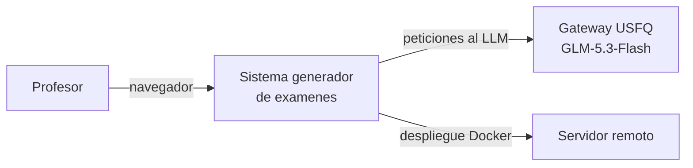
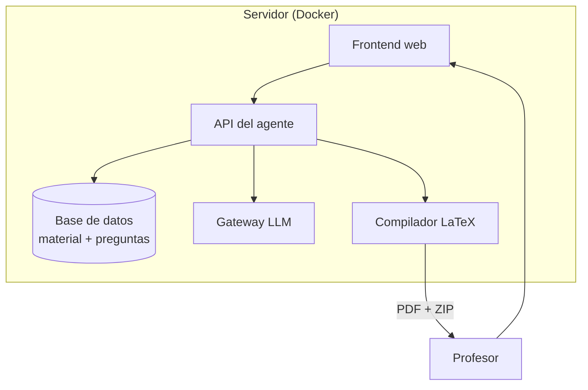
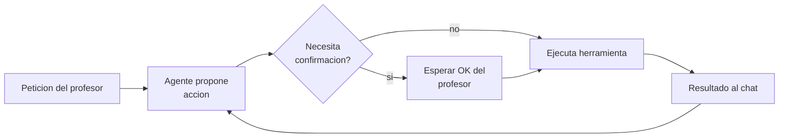
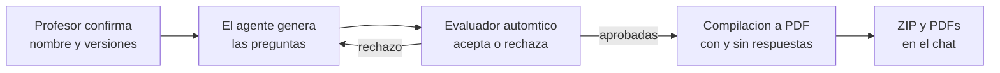

# Diagramas para la tesis

Esta es la seleccion reducida y legible de los graficos de infraestructura, pensada
para el documento de tesis: pocos diagramas, etiquetas cortas y explicaciones de dos
o tres frases. La referencia tecnica completa sigue en [`graphs.md`](./graphs.md).

Regla practica: no incluyas los cuatro diagramas en la tesis. Recomendacion: el
diagrama 1 en el capitulo de arquitectura y el diagrama 3 en el capitulo de
experimentacion; agrega el 2 o el 4 solo si un revisor pide mas detalle.

## 1. Contexto general del sistema

El profesor interactua por chat: sube material, revisa preguntas generadas y descarga
el examen en PDF. El unico componente externo es el gateway de la universidad, que
sirve el modelo de lenguaje.

## 2. Arquitectura simplificada

Tres bloques bastan para explicar el sistema: la interfaz web, el agente con su base
de datos, y la compilacion a PDF. El material del curso se guarda en la base de datos
con vectores, lo que permite al agente responder con contenido del curso (RAG).

## 3. Bucle del agente con confirmacion humana

El agente funciona en un bucle: propone, ejecuta herramientas y devuelve resultados.
Las acciones que modifican datos (guardar, borrar, generar examen) exigen confirmacion
explicita del profesor antes de ejecutarse.

## 4. Generacion de un examen (de chat a PDF)

Detras de una sola peticion de chat, el sistema genera cada pregunta, la evalua
automaticamente y repite las rechazadas; al final compila los items aprobados en dos
versiones de PDF y las entrega como ZIP dentro de la conversacion.

---

Fuente tecnica: [`graphs.md`](./graphs.md). Si un flujo visible para el profesor
cambia, actualiza ambos archivos en el mismo commit.
