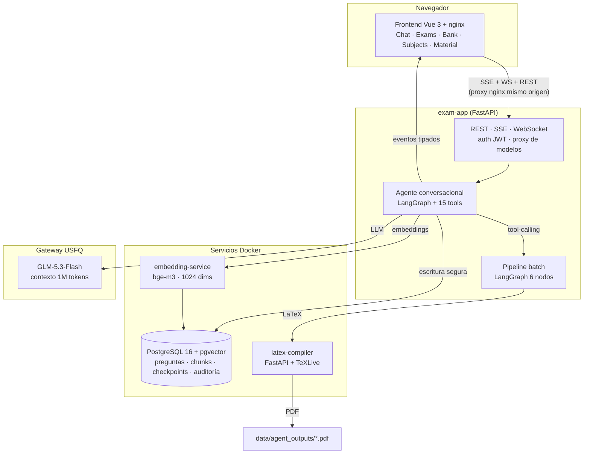
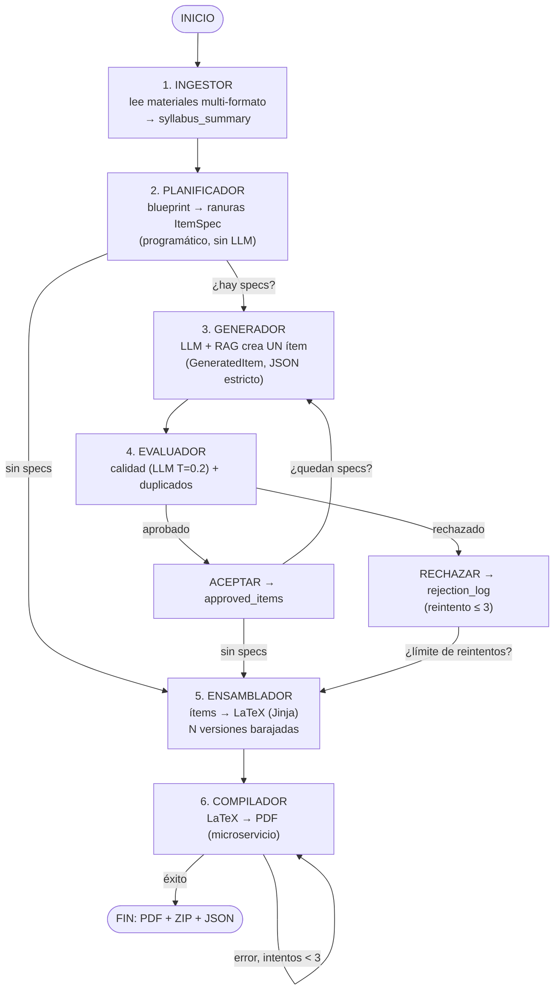
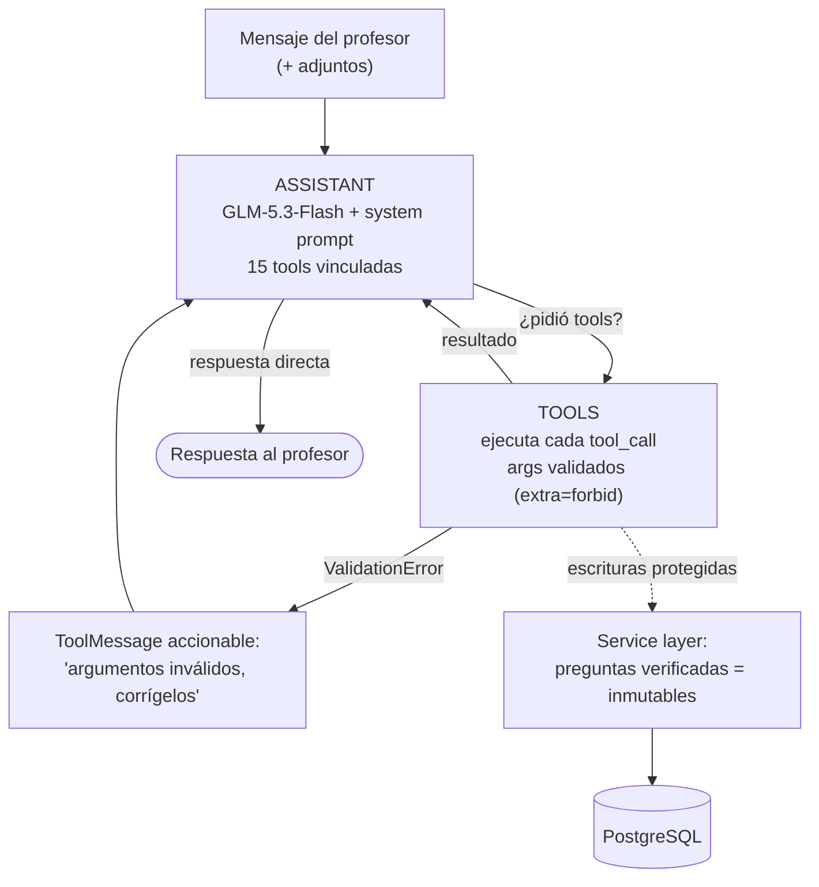
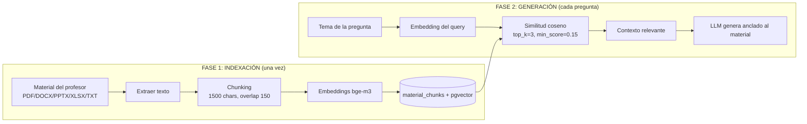

# 🎓 Informe de Implementación Completa del Sistema — Generador Conversacional de Exámenes con Agentes IA

> **Tesis USFQ — Cohorte 3 (2.ª corte) · Estudiante:** Danilo Pilacuán · **Tutor:** Felipe Grijalva
> **Fecha del informe:** 2026-10-26 · **Versión del sistema:** RC2 (rama `RC2/develop`)
> **Propósito:** documento único de referencia para el capítulo de implementación de la tesis y para la defensa: qué se construyó, cómo funciona por dentro, qué se midió y cómo demostrarlo.

---

## Tabla de contenidos

1. [Resumen ejecutivo](#1-resumen-ejecutivo)
2. [Visión general del sistema](#2-visión-general-del-sistema)
3. [Arquitectura general](#3-arquitectura-general)
4. [Infraestructura y despliegue](#4-infraestructura-y-despliegue)
5. [Pipeline batch de generación (6 nodos)](#5-pipeline-batch-de-generación-6-nodos)
6. [Agente conversacional (loop ReAct + HITL)](#6-agente-conversacional-loop-react--hitl)
7. [Las 15 tools del agente](#7-las-15-tools-del-agente)
8. [RAG: recuperación aumentada](#8-rag-recuperación-aumentada)
9. [Seguridad, multi-tenancy y human-in-the-loop](#9-seguridad-multi-tenancy-y-human-in-the-loop)
10. [Frontend (Vue 3)](#10-frontend-vue-3)
11. [Framework de evaluación y benchmarking](#11-framework-de-evaluación-y-benchmarking)
12. [Resultados de la campaña experimental (102 runs)](#12-resultados-de-la-campaña-experimental-102-runs)
13. [Calidad del software: 5 rondas de QA](#13-calidad-del-software-5-rondas-de-qa)
14. [Métricas del proyecto](#14-métricas-del-proyecto)
15. [Estado actual y limitaciones](#15-estado-actual-y-limitaciones)
16. [Trabajo futuro](#16-trabajo-futuro)
17. [Guion de defensa: cómo explicarlo y demostrarlo](#17-guion-de-defensa-cómo-explicarlo-y-demostrarlo)

---

## 1. Resumen ejecutivo

Se construyó un **sistema multi-agente de extremo a extremo** que genera exámenes universitarios en LaTeX (PDF, con y sin respuestas, múltiples versiones anti-copia) a partir del material de una materia, bajo **supervisión humana (human-in-the-loop)** y con **verificación automática por IA** de cada pregunta.

**Cifras clave del resultado:**

| Dimensión | Valor |
|---|---|
| Líneas de código fuente (6 módulos + framework de evaluación) | **~12.700 LOC** |
| Arquitectura | Monorepo con **6 submódulos git** + meta-repo |
| Servicios Docker | 6 (PostgreSQL+pgvector, exam-app, agents, LaTeX, embeddings, frontend) |
| Pipeline batch | **6 nodos LangGraph** (ingestor → planner → generator → evaluator → assembler → compiler) |
| Agente conversacional | Loop ReAct con **15 tools**, checkpointer Postgres persistente |
| Auditoría LLM | **3.220 llamadas registradas** (prompt + respuesta cruda por llamada) |
| Banco de preguntas de producción | **1.237 preguntas** en 7 materias |
| Campaña experimental | **102 runs reales** con GLM-5.3-Flash; **5 hipótesis resueltas** |
| Rondas de QA | **5 rondas**, 18 defectos detectados y corregidos, matriz C1–C20 + R1–R7 |
| Documentación de ingeniería | 22 especificaciones IMPL, 19 defectos, 22 ítems de backlog, 3 requisitos |

**Resultado científico principal:** la configuración de producción del agente (temperatura del generador 0.7, temperatura del evaluador 0.2, top_k del RAG 3) quedó **validada empíricamente** mediante una campaña OFAT (One-Factor-At-a-Time) controlada con materias clonadas como grupo de control, con tasas de aprobación de 0.90–0.96 y robustez entre "profesores" de σ=0.665 (< umbral 1.0).

---

## 2. Visión general del sistema

### 2.1 Problema

La elaboración de exámenes universitarios es una tarea manual, lenta y difícil de estandarizar: el profesor debe redactar preguntas alineadas con la taxonomía de Bloom, balancear dificultad y cobertura temática, evitar duplicados, producir versiones alternativas para evitar copias y dar formato al documento final. Los LLM genéricos ayudan a redactar, pero alucinan contenido fuera del material del curso y no garantizan estructura ni trazabilidad.

### 2.2 Solución

Un **asistente conversacional de cátedra** (agente con tools + RAG sobre el material real del curso) que trabaja **pregunta por pregunta junto al profesor**, más un **pipeline batch** que genera exámenes completos con control de calidad automático por ítem. El profesor conserva siempre la última palabra: nada se guarda sin su confirmación, y las preguntas que aprueba quedan **inmutables para el agente**.

### 2.3 Los dos modos de uso

| | Modo conversacional (chat) | Modo batch (formulario/API) |
|---|---|---|
| Granularidad | Pregunta por pregunta | Examen completo de una vez |
| Quién decide el flujo | El LLM (tool-calling) | Grafo fijo con condicionales |
| Control de calidad | Verificación IA + confirmación humana | Evaluador automático por ítem (reintentos) |
| Persistencia | Checkpointer Postgres (multi-sesión) | Estado en memoria del run + BD |
| Uso principal | Trabajo diario del profesor | Generación masiva / experimentación |

---

## 3. Arquitectura general



### 3.1 Monorepo con submódulos

| Submódulo | Contenido | LOC | Responsabilidad |
|---|---|---|---|
| `projects/core` | Dominio, esquemas Pydantic, service layer, modelos BD, migraciones (9) | 2.121 | Contrato único del dominio (enums, schemas) + persistencia |
| `projects/agents-backend` | Pipeline batch + agente conversacional + 15 tools + prompts | 2.950 | Toda la inteligencia de agentes (LangGraph) |
| `projects/exam-app` | API FastAPI: REST, SSE, WS, auth JWT, endpoints de files/output | 1.869 | Capa de transporte y multi-tenancy |
| `projects/latex-compiler` | Microservicio de compilación (pdflatex ×2) | 49 | Aislamiento de TeXLive en contenedor propio |
| `projects/frontend` | SPA Vue 3: chat, widgets, 5 vistas, i18n en/es | 4.168 | Interfaz del profesor |
| `test/evaluation` | Framework de evaluación (harness, 6 familias de métricas, reportes) | 1.561 | Experimentación reproducible |

**Decisión de diseño defendible:** el contrato del dominio (enums de Bloom/dificultad/tipos, schemas Pydantic, service layer) vive en un paquete único (`core`) que los demás submódulos importan. Así no hay divergencia de tipos entre el chat, el pipeline y la API: un cambio de contrato se hace en un solo lugar.

---

## 4. Infraestructura y despliegue

### 4.1 Servicios Docker Compose

| Servicio | Imagen base | Puerto | Rol |
|---|---|---|---|
| `exam_postgres_db` | PostgreSQL 16 + pgvector | 5432 | Banco, chunks RAG, checkpoints, auditoría LLM (12 tablas) |
| `exam_app` | Python 3.11 + FastAPI + LangGraph | 8000 | API única: REST/SSE/WS, aplica migraciones Alembic al arrancar |
| `latex_compiler` | Python + TeXLive completo | 8081 | Compila LaTeX → PDF (doble pasada para referencias) |
| `embedding-service` | bge-m3 (endpoint OpenAI-compatible) | 9050 | Embeddings de chunks y enunciados (1024 dims) |
| `exam_frontend` | Node build + nginx | **3000** | SPA + proxy único con enrutamiento por cabecera `Accept` |
| Open WebUI (perfil `legacy`) | — | 3001 | Interfaz legada opcional vía `/v1/chat/completions` |

### 4.2 Las 12 tablas de la base de datos

| Tabla | Propósito |
|---|---|
| `users` | Profesores (multi-tenant: scoping por `owner_id`) |
| `subjects` | Materias de cada profesor |
| `material_chunks` | Fragmentos indexados del material con embedding (pgvector) |
| `generated_questions` | Banco de preguntas (1.237 filas) con verificación humano/IA |
| `syllabus_topics` | Temas del syllabus por materia |
| `exams` | Un registro por examen generado (blueprint, ítems, artifacts) |
| `llm_responses` | **Auditoría cruda**: prompt, respuesta, modelo y timestamps de cada llamada LLM |
| `checkpoints` / `checkpoint_blobs` / `checkpoint_writes` / `checkpoint_migrations` | Estado persistente de las conversaciones (LangGraph PostgresSaver) |
| `alembic_version` | Versionado de migraciones |

### 4.3 Enrutamiento del frontend (patrón clave)

nginx enruta por **cabecera `Accept`**: si el navegador pide `application/json` a `/subjects`, el proxy lo manda al backend; si pide HTML (navegación SPA), sirve el `index.html` de Vue. Un solo puerto (3000) y un solo origen: sin CORS, sin cookies de terceros. Lección aprendida en QA (BUG-017b): este patrón exige probar **todos los métodos HTTP de cada prefijo**, no solo los GET.

---

## 5. Pipeline batch de generación (6 nodos)



### 5.1 Decisiones de diseño de cada nodo

1. **Ingestor** — extrae texto de PDF/DOCX/PPTX/XLSX/TXT y produce un resumen del syllabus. No gasta LLM.
2. **Planner** — convierte el blueprint en `ItemSpec`s concretas ("ranura #3: tema X, Bloom=analizar, dificultad=dura, tipo=multiple_choice"). Es **programático y determinista**: barato, reproducible (semilla fijada) y fácil de defender metodológicamente: la estructura del examen la decide un algoritmo, no un LLM.
3. **Generator** — recupera contexto RAG del tema y pide al LLM **UNA pregunta por llamada** con `with_structured_output(GeneratedItem)`: JSON estricto validado con Pydantic. **El LLM nunca escribe LaTeX** — separación total entre contenido y formato.
4. **Evaluator** — LLM independiente (temperatura baja 0.2) puntúa calidad 0-10 y valida coincidencia de dificultad/tipo; la **deduplicación** se hace por similitud de tokens contra lo ya aprobado (umbral 0.82).
5. **Assembler** — Jinja2 → LaTeX con **N versiones barajadas estilo AMC** (anti-copia) + hoja de respuestas.
6. **Compiler** — microservicio con TeXLive, doble pasada `pdflatex`, hasta 3 reintentos.

### 5.2 Guardrails del loop

- Una pregunta por llamada LLM (contexto acotado, salida validable).
- JSON estructurado obligatorio en todas las salidas del LLM.
- Evaluador independiente del generador (no se auto-aprueba).
- Reintentos acotados (≤3 por ranura) con `rejection_log` completo (auditoría).
- Cap duro de llamadas (`max_total_llm_calls=200`).

**Medición real del pipeline completo (QA ronda 5, banco vacío):** 16 llamadas LLM para 8 preguntas (2.0 por ítem), 0 rechazos, 2 PDFs + ZIP en ~2 minutos.

---

## 6. Agente conversacional (loop ReAct + HITL)



### 6.1 Características que lo definen

- **Ciclo ReAct estándar**: el LLM decide si responde o invoca tools; los resultados vuelven como `ToolMessage` y el ciclo continúa hasta responder sin tools.
- **Validación en el borde con auto-corrección**: si el LLM inventa un argumento (`difficulty="imposible"`), Pydantic lo rechaza (`extra="forbid"`) y el error accionable vuelve como `ToolMessage`; el agente **corrige y reintenta solo**, sin crashear el grafo.
- **Human-in-the-loop a nivel de prompt** (`WRITE_TOOLS`): el agente pregunta "¿La guardo? ¿La confirmas como verificada?" antes de ejecutar herramientas de escritura. El `interrupt` nativo de LangGraph se descartó porque el transporte SSE/WS no reanuda interrupciones — decisión documentada.
- **Memoria persistente**: checkpointer PostgresSaver por `thread_id`; la conversación sobrevive reinicios del contenedor (149 blobs de checkpoint en producción).
- **Puente del ítem pendiente**: `generate_question` deja el ítem en un `PendingItemStore` sincronizado con el checkpointer; `save_pending_question` lo re-valida y persiste. Esto evita que el LLM re-especifique 11 campos (fuente típica de errores de tool-calling).

---

## 7. Las 15 tools del agente

| # | Tool | Categoría | Acción | Escribe BD |
|---|---|---|---|---|
| 1 | `list_subjects` | Lectura | Lista materias | No |
| 2 | `search_questions` | Lectura | Consulta el banco (tabla markdown, 15 columnas a pedido) | No |
| 3 | `generate_question` | Generación | Genera UNA pregunta con RAG (no guarda) | No (pendiente) |
| 4 | `save_question` | Escritura | Guarda con verificación IA previa | Sí |
| 5 | `save_pending_question` | Escritura | Persiste el ítem pendiente re-validado | Sí |
| 6 | `confirm_human_verification` | Escritura | Inmutabiliza (`verified_by_human=True`) | Sí |
| 7 | `update_question_tool` | Escritura | Actualiza (guardrail: verificadas inmutables) | Sí |
| 8 | `delete_question_tool` | Escritura | Elimina (guardrail: verificadas no se borran) | Sí |
| 9 | `generate_exam_pdf` | Examen | Banco → pipeline → LaTeX → PDF+ZIP adjuntos | No |
| 10 | `add_material_file` | RAG | Indexa un adjunto del chat como material | Sí |
| 11 | `list_subject_material` | Lectura | Auditoría del material indexado | No |
| 12 | `delete_material_file_tool` | RAG | Elimina archivo + sus chunks | Sí |
| 13 | `register_subject` | Escritura | Alta de materia (anti-duplicado) | Sí |
| 14 | `select_subject` | Contexto | Materia activa (selector reactivo del frontend) | No |
| 15 | `export_questions` | Lectura | Exporta a CSV/XLSX/JSON adjunto | No |

**Cobertura completa del CRUD desde el chat**: preguntas (tools 3-8) y material (10-12). Los cuatro invariantes de todas las tools:

1. **Entrada validada con Pydantic** (`args_schema`, `extra="forbid"`).
2. **Escritura solo vía service layer** — nunca SQL directo.
3. **Salida amigable para el chat** (markdown, errores truncados y accionables).
4. **Hiperespecialización** — rechaza peticiones fuera del ámbito académico (keywords off-topic).

---

## 8. RAG: recuperación aumentada



- **Embeddings**: bge-m3 (1024 dims) servido como microservicio con endpoint OpenAI-compatible.
- **Indexación en producción**: 219 chunks activos (465 en la validación E2E con Economía Aplicada).
- **Hiperparámetros validados empíricamente**: top_k=3 (ver §12, E02) y min_score=0.15.
- **Doble uso**: el mismo índice alimenta la generación de preguntas y la deduplicación por embedding del enunciado al guardar.

---

## 9. Seguridad, multi-tenancy y human-in-the-loop

| Capa | Mecanismo | Evidencia |
|---|---|---|
| Autenticación | JWT por profesor en toda la API (REST, SSE, WS) | C1 certificado en 3 rondas; 401 sin token |
| Aislamiento multi-tenant | Scoping por `owner_id`: 403 si la materia es de otro profesor | C4 + sondas ronda 5: un profesor solo ve sus materias |
| Inmutabilidad HITL | `verified_by_human=True` ⇒ `SecurityError` en update/delete desde el service layer | R2 (guardrail anti-borrado) certificado |
| Confirmación explícita | Las tools de escritura exigen confirmación del profesor a nivel de prompt | R1 (HITL textual) certificado |
| Auditoría total | Tabla `llm_responses` con prompt + respuesta cruda de cada llamada (chat y pipeline) | 3.220 registros en producción |
| Verificación IA | `review_question` antes de persistir: ambigüedad, corrección, relevancia → `verified_by_ai`, notas y prioridad | Fail-safe: si falla el LLM, marca no verificada y deriva a humano |

---

## 10. Frontend (Vue 3)

- **5 vistas**: Chat (agente), Exams (generación por formulario + histórico), Bank (banco de preguntas con filtros, toggle de verificación y detalle), Subjects, Material.
- **Chat con streaming real**: SSE para el turno del agente + WebSocket para eventos tipados (`artifact_ready` renderiza la card de descarga, `material_indexed` lanza toast, `subject_selected` sincroniza el selector bidireccionalmente).
- **Widgets reactivos en el chat**: cards de preguntas generadas, cards de descarga de PDF/ZIP, tablas markdown con scroll propio.
- **i18n en/es**: todo el contrato interno (enums, tools, prompts, API) está en inglés; la UI es bilingüe.
- **Gestión de errores accionable** (C12): `apiFetch` mapea 413/401/403 a mensajes concretos con banner y reintento.
- **4.168 líneas** en 39 archivos (Vue + TS).

---

## 11. Framework de evaluación y benchmarking

Construido en `test/evaluation/` (1.561 LOC) para responder con datos la pregunta central de la tesis: **¿qué tan bien genera este agente y cuál es su configuración óptima?**

### 11.1 Diseño

- **Registro central de modelos** (`models.yaml`): cualquier proveedor OpenAI-compatible se añade sin tocar código (nombre lógico, base_url, modelo, modo real/stub).
- **Control experimental con materias clonadas**: 5 clones (Eva, María, Sofía, Lucía, Pablo) con el **mismo material** y nombres distintos. Así la varianza entre clones es atribuible solo al LLM, no al contenido.
- **Experimentos OFAT** (`experiments.yaml`): brazos que sobrescriben un hiperparámetro a la vez (temperatura del generador, top_k del RAG, temperatura del evaluador) sobre un blueprint fijo de 8 preguntas.
- **Reproducibilidad**: cada run guarda en `runs.jsonl` la config completa, blueprint, specs, ítems, evaluaciones, rechazos y latencias. `--dry-run` valida todo el harness con stubs deterministas sin coste.

### 11.2 Las 6 familias de métricas

| Familia | Métricas | Fuente |
|---|---|---|
| Calidad | `quality_score` (0-10), tasa de aprobación, intentos por ítem, rechazos | Estado del pipeline |
| Diversidad | Similitud coseno por pares (bge-m3), cobertura de temas/Bloom | Embeddings de ítems |
| RAG | Retrieval score, faithfulness léxica + **judge LLM** | Auditoría + chunks |
| Alineación | Accuracy del generador vs spec (Bloom/dificultad) | `GeneratedItem` vs `ItemSpec` |
| Coste | Llamadas por ítem aprobado, tokens por ítem, latencia | Auditoría + usage |
| Estado del arte | Robustez (σ entre clones), self-consistency (Wang 2022), pass@k (Chen 2021) | Agregación de runs |

### 11.3 El judge LLM de faithfulness

La faithfulness léxica (overlap de tokens) premia la **copia** sobre la **síntesis**. Se implementó un juez post-hoc: un LLM (misma config, T=0) puntúa 0-1 el soporte factual del enunciado contra los chunks recuperados, corre sobre la auditoría sin interferir con el pipeline evaluado, y es intercambiable (`model_profile`) para experimentos self-judge vs cross-judge.

---

## 12. Resultados de la campaña experimental (102 runs)

**Campaña real**: 27 (E01) + 27 (E02) + 30 (E03) + 18 (E04) = **102 runs** con GLM-5.3-Flash vía gateway USFQ. Todos los runs archivados con `runs.jsonl` + `aggregate.json` + reportes con plots.

### 12.1 Hipótesis y veredictos

| Hipótesis | Enunciado | Veredicto | Evidencia |
|---|---|---|---|
| **H1 Capacidad** | aprobación ≥ 70% y quality ≥ 7/10 | ✅ **Confirmada** | aprobación 0.90-0.96; quality 6.5-7.5 según brazo |
| **H2 Temperatura** | existe un óptimo intermedio, no monótono | ✅ **Confirmada** | U invertida: 0.889 (T=0.3) → **0.917 (T=0.7)** → 0.861 (T=1.0) |
| **H3 Diversidad** | similitud por pares < 0.82 (umbral anti-dup) | ✅ **Confirmada** | 0.51 ± 0.03 — el mecanismo anti-dup no se dispara en operación normal |
| **H4 RAG top_k** | k=3 equilibra calidad y coste | ✅ **Confirmada** | k=3: aprobación 0.958; k=8 duplica tokens (2.09k→3.93k) sin ganar calidad |
| **H5 Robustez** | σ entre clones < 1.0 | ✅ **Confirmada** | σ=0.665 con 4 réplicas/clon (convergió desde 1.051 con 2 réplicas) |

### 12.2 E01 — Temperatura del generador (27 runs)

| Métrica | T=0.3 | **T=0.7 (prod.)** | T=1.0 |
|---|---|---|---|
| Aprobación | 0.889 | **0.917** | 0.861 |
| Quality medio | 6.39 | **6.51** | 6.43 |
| Reintentos/ítem | 0.125 | **0.097** | 0.153 |
| Bloom accuracy | 0.889 | **0.917** | 0.861 |
| Tokens/ítem | 2.227 | **2.137** | 2.287 |

**Hallazgos clave para la defensa**: (1) la relación calidad-temperatura es una **U invertida suave** — el óptimo empírico coincide con la configuración de producción; (2) T=1.0 degrada la alineación spec-ítem (el modelo se desvía del nivel de Bloom pedido) — ese es el mecanismo concreto detrás de los rechazos; (3) el coste es plano entre temperaturas: la decisión se toma por calidad, no por coste.

### 12.3 E02 — Barrido top_k del RAG (27 runs)

| Métrica | top_k=1 | **top_k=3 (prod.)** | top_k=8 |
|---|---|---|---|
| Aprobación | 0.833 | **0.958** | 0.875 |
| Bloom accuracy | 0.833 | **0.958** | 0.875 |
| Tokens/ítem | 1.554 | 2.088 | **3.934** |

**Hallazgos clave**: (1) k=3 es el punto dulce entre contexto insuficiente (k=1) y diluido (k=8); (2) el coste escala linealmente con k y k=8 queda **estrictamente dominado** (más caro y peor aprobador); (3) la **paradoja del faithfulness** — k=1 y k=8 puntúan más alto que k=3 en overlap léxico porque copian más; el judge LLM (§12.6) resuelve esta ambigüedad.

### 12.4 E03 — Robustez entre clones (30 runs, 5 clones × 4 réplicas)

| Métrica | Media ± σ |
|---|---|
| Aprobación | 0.904 ± 0.10 |
| Quality medio | 6.61 ± 1.27 |
| **σ entre clones** | **0.665** (< umbral 1.0) |
| Similitud por pares | 0.508 ± 0.03 |
| Coste | 2.21 ± 0.27 llamadas/ítem; 2.166 ± 287 tokens/ítem |

**Hallazgos clave**: (1) con 4 réplicas el estimador converge — la varianza observada es la estocástica pura del LLM a T=0.7, no sensibilidad al material; (2) el retrieval score es extremadamente estable (0.466 ± 0.004): cuando hay varianza en faithfulness, viene del generador, no del recuperador.

### 12.5 E04 — Temperatura del evaluador (18 runs)

| Métrica | T=0.0 | **T=0.2 (prod.)** | T=0.6 |
|---|---|---|---|
| Quality medio | 6.77 | **7.55** | 6.30 |
| σ intra-run | 3.45 | **2.34** | 2.99 |
| σ entre clones | **0.099** | 0.339 | 0.666 |

**Hallazgos clave**: (1) la aprobación apenas cambia con la temperatura del juez (0.917-0.958) pero el quality medio y la estabilidad sí; (2) la robustez entre clones **se degrada monótonamente** con la temperatura del evaluador → recomendación defendible: T_juez ≤ 0.2; (3) se detectó y documentó una **inconsistencia de LLM-as-judge** (quality 0.92/10 con approved=true en un intento): material honesto de discusión sobre fiabilidad del juez automático.

### 12.6 Judge LLM de faithfulness (27/30 runs de E03)

| Métrica | Media ± σ | Lectura |
|---|---|---|
| Judge LLM (soporte factual) | **0.352 ± 0.052** | varianza BAJA |
| Overlap léxico | 0.309 ± 0.260 | varianza ALTA |

El judge es **5× más estable** que la aproximación léxica porque no premia la copia literal: confirma que la alta varianza del léxico era ruido de la métrica, no del pipeline.

### 12.7 Configuración final validada del sistema

```yaml
generador:      { modelo: GLM-5.3-Flash, temperatura: 0.7 }
evaluador:      { modelo: GLM-5.3-Flash, temperatura: 0.2 }
rag:            { top_k: 3, min_score: 0.15, embeddings: bge-m3-1024 }
blueprint:      { total_questions: 8, semilla_planner_fija: true }
resultado:      { aprobación: 0.90-0.96, quality: 6.5-7.5, coste: ~2.2 llamadas/ítem }
```

---

## 13. Calidad del software: 5 rondas de QA

| Ronda | Fecha | Alcance | Resultado |
|---|---|---|---|
| 1 | 2026-10-19 | E2E inicial del caso de uso central | 12 bugs detectados |
| 2 | 2026-10-23 | Persistencia, registros, multi-tenant (P1-P9) | BUG-013/014 corregidos |
| 3 | 2026-10-23 | Certificación central (C1-C13, R1-R7) | 11 fixes verificados |
| 4 | 2026-10-26 | Navegación y scroll (Playwright, navegador real) | BUG-017/017b corregidos |
| 5 | 2026-10-26 | Regresión API tras el instruccionado (C16-C20) | BUG-017b re-verificado; BUG-018 abierto (hardening) |

- **18 defectos corregidos y verificados** de 19 documentados (BUG-018 abierto como endurecimiento, no afecta a la UI).
- **Matriz de certificación**: C1-C20 (casos de uso) + R1-R7 (regresión), con evidencia por ronda en `.ops/qa/test-plan.md`.
- **Trazabilidad completa**: REQ → BL → IMPL → QT → BUG documentada en `.ops/qa/traceability.md`.
- El caso de uso central (login → materia → material → preguntas HITL → examen → PDF/ZIP) está **verificado end-to-end 5 veces**, incluida generación con banco vacío, multi-tenant y descarga de artefactos vía nginx.

---

## 14. Métricas del proyecto

### 14.1 Escala del código

| Módulo | Archivos | Líneas |
|---|---|---|
| core (dominio, service layer, BD, 9 migraciones) | 37 py | 2.121 |
| agents-backend (pipelines, tools, prompts) | 18 py | 2.950 |
| exam-app (API, auth, SSE/WS) | 30 py | 1.869 |
| latex-compiler | 2 py | 49 |
| frontend (Vue 3 + TS) | 39 | 4.168 |
| framework de evaluación | 19 py | 1.561 |
| **Total** | **~145** | **~12.700** |

### 14.2 Escala de los datos de producción

| Métrica | Valor |
|---|---|
| Preguntas en el banco | 1.237 (443/389/279/55/50 en clones de evaluación + 21 en la materia real) |
| Verificación humana | 10 preguntas verificadas por humano; 6 por IA |
| Chunks RAG activos | 219 |
| Auditoría LLM | 3.220 llamadas registradas con prompt y respuesta cruda |
| Exámenes persistidos | 5 (todos con ZIP) |
| Checkpoints de conversación | 149 blobs |
| Materias | 7 (1 real + 5 clones de evaluación + 1 adicional) |

### 14.3 Escala de la ingeniería documental

| Documento | Cantidad |
|---|---|
| Especificaciones de implementación (IMPL) | 22 |
| Defectos documentados con evidencia (BUG) | 19 |
| Backlog priorizado (BL) | 22 |
| Requisitos (REQ) | 3 |
| Diagramas mermaid en la documentación técnica | 13+ |

### 14.4 Latencias y coste observados

| Operación | Valor típico |
|---|---|
| Generación de 1 pregunta (chat, con RAG) | segundos |
| Examen completo batch de 8 preguntas | ~0.5-4 min (16 llamadas LLM) |
| Llamadas LLM por ítem aprobado | 2.1-2.3 |
| Tokens por ítem (estimado) | ~2.100 |
| Compilación LaTeX (doble pasada) | segundos |
| Artefactos por examen | PDF sin respuestas + PDF con respuestas × N versiones + ZIP + JSON |

---

## 15. Estado actual y limitaciones

### 15.1 Estado

- **RC2 congelado para la escritura de la tesis** (rama `RC2/develop`, todo publicado en origin).
- 21 de 22 etapas del plan ejecutadas y certificadas; la migración documental `.ops` (IMPL-020) queda `borrador` pendiente de la revisión del propietario.
- 2 defectos abiertos, ambos menores: **BUG-016** (401 transitorio tras reiniciar el backend; requiere un retry) y **BUG-018** (endurecimiento: Pydantic descarta campos desconocidos del blueprint sin 422; la UI no está afectada).

### 15.2 Limitaciones conocidas (declaradas y defendibles)

1. **Tokens por llamada no reportados por el gateway USFQ** — se estiman (chars/4) desde la auditoría; documentado en el framework.
2. **`reasoning_effort > none` rompe `with_structured_output`** en el pipeline batch (limitación del proveedor); los experimentos de reasoning aplican al chat.
3. **Faithfulness léxica aproxima mal la síntesis** — mitigado con el judge LLM; ambos métodos documentados.
4. **Latencia bimodal del gateway** (multitenant compartido): efecto de carga, no atribuible a los hiperparámetros; se registra como nota metodológica, no como causal.
5. **Un solo proveedor evaluado** (GLM-5.3-Flash): el registro de modelos soporta comparativa cross-provider, pero no se ejecutó (acceso limitado a otros modelos del gateway).
6. **Sin suite automatizada versionada** (BL-010): las 5 rondas de QA son procedimientos manuales documentados con evidencia, no CI end-to-end.

---

## 16. Trabajo futuro

| Prioridad | Ítem | Detalle |
|---|---|---|
| 1 | Escrito de la tesis (capítulo de experimentación) | Usa directamente §12 + `test/evaluation/experiments/*/FINDINGS.md` |
| 2 | Suite Playwright versionada (BL-010) | Convertir C1-C20/R1-R7 en CI reproducible |
| 3 | Robustez de sesión (BL-008) | ISS-17 materia activa tras recarga + retry BUG-016 + endurecimiento BUG-018 (`extra="forbid"`) |
| 4 | Comparativa cross-provider | Cambiar `model_profile` en `models.yaml` y repetir E01-E04 (diseño ya preparado) |
| 5 | Repos remotos + CI de submódulos (etapa 01) | Publicar los 6 submódulos con pipelines propios |

---

## 17. Guion de defensa: cómo explicarlo y demostrarlo

### 17.1 El pitch de 60 segundos

> "Mi tesis construye un agente de IA que genera exámenes universitarios en LaTeX a partir del material real de una materia. El sistema tiene dos modos: un asistente conversacional que trabaja pregunta por pregunta con el profesor —con verificación automática de IA y control humano antes de guardar— y un pipeline batch de 6 nodos que genera el examen completo con evaluador de calidad por ítem, versiones alternativas anti-copia y hoja de respuestas. Todo el contenido se ancla al material mediante RAG con pgvector, toda llamada al LLM queda auditada, y las preguntas que el profesor aprueba quedan inmutables para el agente. Validé la configuración del sistema con 102 experimentos reales que demuestran que el óptimo de temperatura, el top_k de recuperación y la robustez del pipeline —es decir, la configuración de producción quedó confirmada empíricamente."

### 17.2 Las 5 preguntas que casi seguro harán (y respuestas con datos)

1. **"¿Cómo evitas que el modelo alucine contenido fuera del curso?"** → RAG con anclaje por embeddings (bge-m3, top_k=3 validado en E02), JSON estructurado obligatorio validado con Pydantic, evaluador independiente por ítem, y verificación IA previa al guardado. Evidencia: faithfulness del judge 0.352 ± 0.052 (soporte factual estable).

2. **"¿Qué pasa si el modelo genera una pregunta mala?"** → El evaluador (LLM independiente a T=0.2) la rechaza; se reintenta hasta 3 veces; el rechazo queda en el log de auditoría. En 102 runs, el pipeline aprobó 0.90-0.96 de las ranuras con ~2.2 llamadas por ítem aprobado.

3. **"¿Cómo garantizas que el agente no borre ni modifique lo que el profesor aprobó?"** → Service layer con regla de inmutabilidad: `verified_by_human=True` ⇒ `SecurityError` en update/delete, aplicado a tools y a la API REST. Certificado en regresión (R2). Además, toda escritura exige confirmación humana previa a nivel de prompt.

4. **"¿Por qué temperatura 0.7 y no otra?"** → Barrido E01: la aprobación sigue una U invertida (0.889 → 0.917 → 0.861 para 0.3/0.7/1.0); a T=1.0 el modelo se desvía del nivel de Bloom pedido. El evaluador a T=0.2 maximiza quality y estabilidad (E04), y top_k=3 domina a k=8 en coste-calidad (E02).

5. **"¿Es reproducible / cómo descartas que los resultados sean casualidad?"** → Metodología de clones: el mismo material indexado para 5 "profesores" distintos; σ entre clones 0.665 < 1.0 (H5) con 4 réplicas. Cada run guarda su config completa en `runs.jsonl`; hay modo `--dry-run` determinista del harness completo.

### 17.3 Demo sugerida en vivo (10 min, con fallback grabado)

1. **Login + aislamiento** (1 min): dos profesores, uno no ve las materias del otro.
2. **Cargar material + indexar** (2 min): subir un PDF desde el chat (`add_material_file`), ver los chunks.
3. **Generar pregunta con HITL** (3 min): pedir una pregunta difícil de un tema → el agente muestra RAG + verificación IA → guardar → verificar por humano → intentar borrarla por chat (debe fallar con el guardrail) — este momento es el clímax de la demo.
4. **Generar examen completo** (3 min): formulario Exams → 8 preguntas, 2 versiones → card de descarga → abrir ZIP con PDFs A/B con y sin respuestas.
5. **Mostrar la auditoría** (1 min): tabla `llm_responses` en la BD con el prompt y la respuesta cruda de cada llamada.

**Fallback**: la ronda de QA 5 dejó verificado que todo esto funciona contra el stack Docker levantado (`docker compose up -d`); tener capturas de los 5 pasos grabadas por si el gateway falla.

### 17.4 Mapa de documentos para el tribunal

| Necesitas | Está en |
|---|---|
| Arquitectura y diagramas | `ARCHITECTURE.md` (13 diagramas), este informe §3-§10 |
| Metodología experimental | `test/evaluation/README.md` §8 |
| Resultados crudos y plots | `test/evaluation/experiments/E0{1..4}/` (FINDINGS.md + aggregate.json + PNG) |
| Calidad del software | `.ops/qa/` (test-plan, traceability, 19 BUG) |
| Estado del proyecto | `PROGRESS.md`, `.ops/project/handoff.md` |
| Este informe | `docs/informe_implementacion.md` |

---

*Informe generado sobre evidencia verificada del repositorio (estado `RC2/develop` @ 2026-10-26): todos los números citados provienen de consultas reales a la base de datos de producción, los artefactos de experimentos (`runs.jsonl`, `aggregate.json`, FINDINGS.md) y las matrices de QA documentadas en `.ops/`.*
