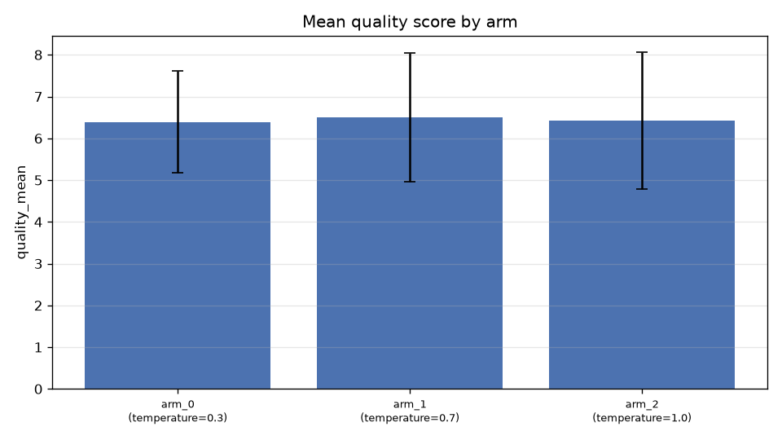
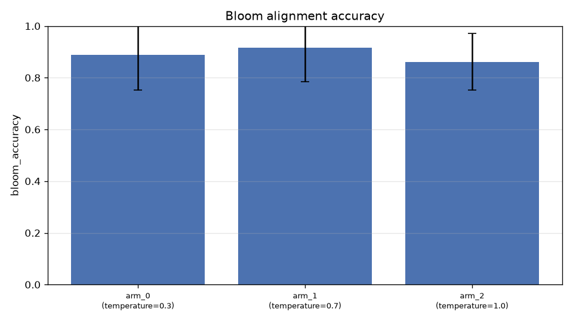
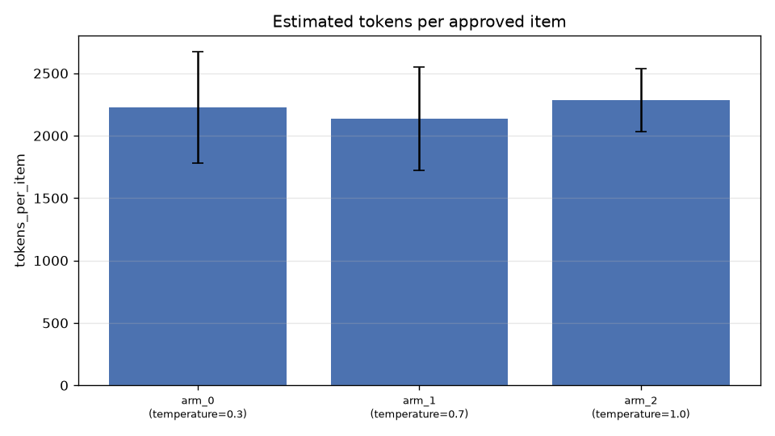

# E01 — Generador: barrido de temperatura 0.3 / 0.7 / 1.0 (RESULTADOS REALES)

> 27 runs reales (3 brazos × 3 clones × 3 repeticiones), GLM-5.3-Flash vía
> gateway USFQ. Evaluador fijo en 0.2 (producción), top_k 3. Todos los runs
> `completed` con PDF.

## Resultados por brazo

| Métrica | gen T=0.3 | gen T=0.7 (producción) | gen T=1.0 |
|---|---|---|---|
| Tasa de aprobación | 0.889 | **0.917** | 0.861 |
| Quality score medio | 6.39 | **6.51** | 6.43 |
| σ intra-run del quality | 3.37 | 3.09 | 3.01 |
| Intentos por ítem aprobado | 0.125 | **0.097** | 0.153 |
| Similitud por pares (diversidad) | 0.519 | 0.501 | 0.502 |
| Bloom accuracy | 0.889 | **0.917** | 0.861 |
| Tokens por ítem (estimado) | 2.227 | **2.137** | 2.287 |
| Llamadas por ítem aprobado | 2.28 | **2.23** | 2.34 |
| Robustez entre clones (σ) | 0.837 | 0.732 | 0.332 |

## Hallazgos

1. **T=0.7 (configuración de producción) es el óptimo del barrido**: mejor
   aprobación (0.917), mejor quality (6.51), menos reintentos (0.097/ítem),
   mejor alineación Bloom (0.917) y menor coste por ítem. La relación
   calidad-temperatura es **no monótona en forma de U invertida suave**
   (0.889 → 0.917 → 0.861), confirmando H2: existe un óptimo intermedio.

2. **T=1.0 degrada la alineación spec-ítem** (Bloom accuracy 0.861 vs
   0.917): a mayor temperatura el modelo se desvía más del spec pedido
   (cambia tipo de pregunta o nivel cognitivo). Es el mecanismo que
   explica los rechazos por difficulty/type mismatch.

3. **Diversidad insensible a la temperatura** (0.50–0.52 en los tres
   brazos): la similitud por pares está dominada por el vocabulario
   compartido del dominio (mismo material), no por la creatividad del
   modelo. Para diversidad real valdría medir con embeddings de ítems
   distintos (future work: métrica de distinción semántica por pares).

4. **Robustez entre clones MEJORA con temperatura alta** (σ: 0.84 → 0.73 →
   0.33): contraintuitivo; con pocas repeticiones (3/clon) puede ser ruido
   muestral. No concluir sin más réplicas.

5. **Coste ~plano** (2.13–2.29 llamadas/ítem, 2.14–2.29k tokens/ítem): el
   coste no es un criterio de decisión entre temperaturas; sí lo son
   aprobación y alineación.

## Implicación de configuración

`llm_temperature=0.7` queda **validado como óptimo empírico** del
generador para este dominio y blueprint.
