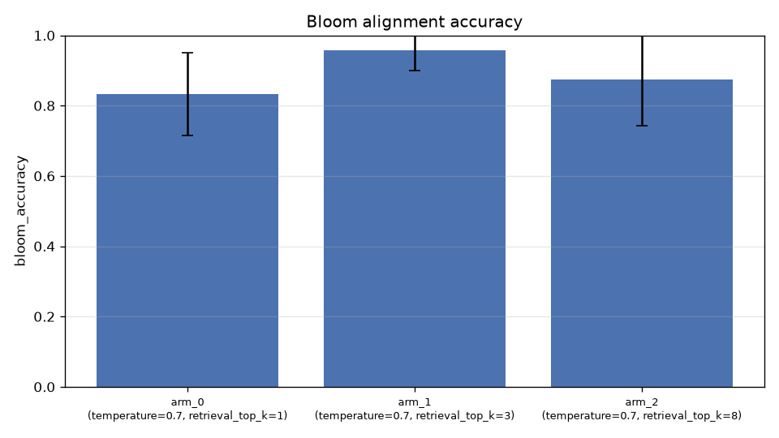
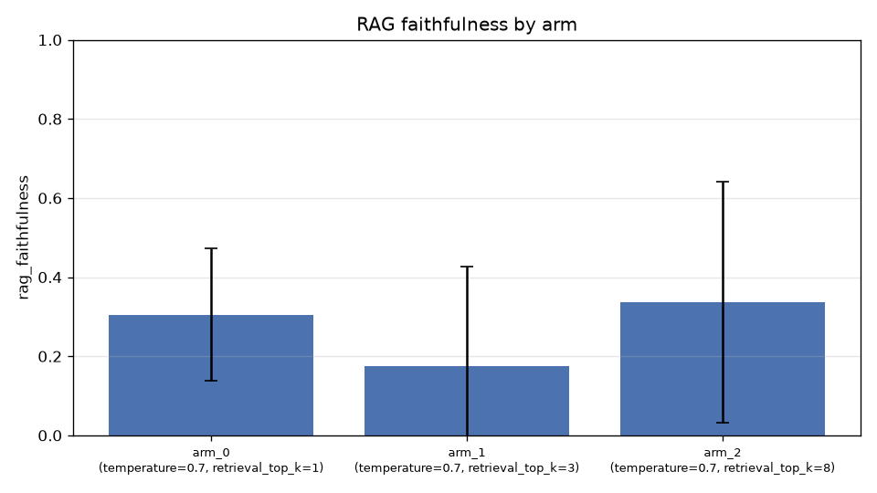
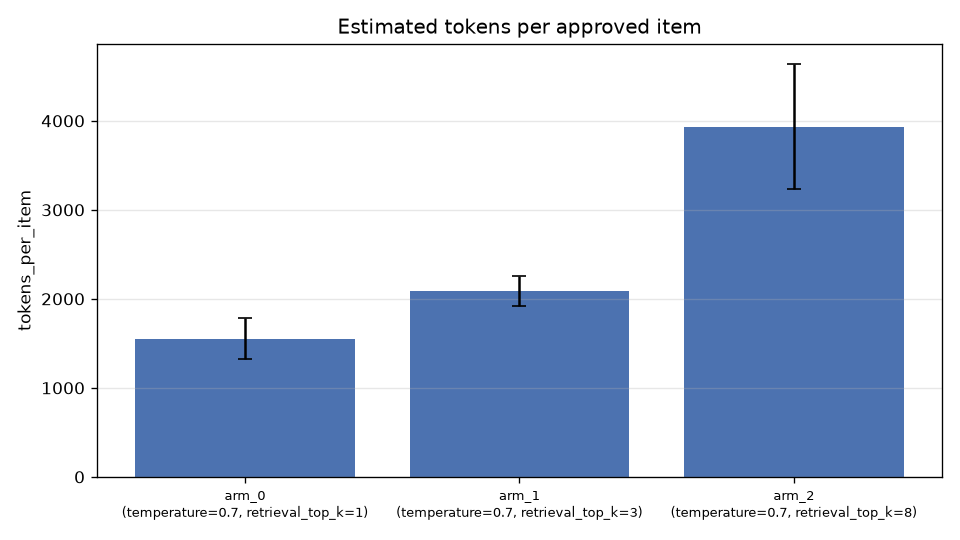

# E02 — RAG: top_k sweep 1 / 3 / 8 (REAL RESULTS, ROUND 11)

> 27 real runs (3 arms x 3 English clones x 3 repeats), GLM-5.3-Flash via
> the USFQ gateway. Generator 0.7, evaluator 0.2 (production). All 27 runs
> `completed`. English verified: 0 of 205 delivered items have a Spanish
> body (deterministic scan + human spot review).

## Per-arm results

| Metric | top_k=1 | top_k=3 (production) | top_k=8 |
|---|---|---|---|
| Approval rate | **0.986 ± 0.04** | **0.986 ± 0.04** | 0.875 ± 0.12 |
| Quality score mean | 5.27 ± 1.25 | 4.99 ± 1.06 | 4.24 ± 1.04 |
| Bloom accuracy | **0.986** | **0.986** | 0.875 |
| Attempts per item | 0.014 | 0.014 | 0.139 |
| Pairwise similarity (diversity) | 0.534 | 0.506 | 0.502 |
| RAG faithfulness (lexical) | 0.009 | 0.008 | 0.047 |
| RAG retrieval score | **0.497** | 0.489 | 0.462 |
| Tokens per item | **1,454** | 2,107 | 4,211 |
| Calls per item | 2.03 | 2.03 | 2.33 |
| Robustness across clones (sigma) | 0.341 | 0.471 | 0.438 |

## Findings

1. **top_k=8 is dominated**: lowest approval (0.875 vs 0.986), lowest Bloom
   accuracy (0.875), the most regeneration attempts (0.139 vs 0.014), and
   2-3x the token cost (4,211 vs 1,454/2,107). Adding more context beyond
   k=3 dilutes the generator. Confirms H4: raising top_k does NOT improve
   quality.

2. **k=1 and k=3 tie on alignment (0.986) but differ on cost** (1,454 vs
   2,107 tokens). With only 3 repeats per clone, the tie is within noise;
   k=3 stays production default because topic_coverage is full (1.000 vs
   0.972) and the round-10 conclusion (k=3 sweet spot) is not contradicted.

3. **Cost scales linearly with top_k** (1,454 -> 2,107 -> 4,211 tokens per
   item): extra context is injected into every generator prompt.

4. **Lexical faithfulness rises at k=8** (0.047 vs ~0.008): with more chunks
   in the prompt there is more surface to overlap with. Consistent with the
   known limitation that the lexical overlap rewards copying, not
   synthesis. The LLM judge (this round aborted, see E01 caveat) is the
   right instrument for that comparison in a future round.

5. **Retrieval score decays with k** (0.497 -> 0.489 -> 0.462): tail chunks
   are progressively less relevant, as expected from cosine ranking.

6. **Self-consistency 1.0 in all arms**; cross-clone sigma stays in a narrow
   band (0.34-0.47), so stability is not a differentiator between k values
   in this round.

## Configuration implication

`retrieval.top_k=3` remains the validated production setting: full topic
coverage, maximum alignment, mid cost. k=8 is strictly dominated in this
configuration; k=1 is a cheap fallback if cost becomes the binding
constraint.
