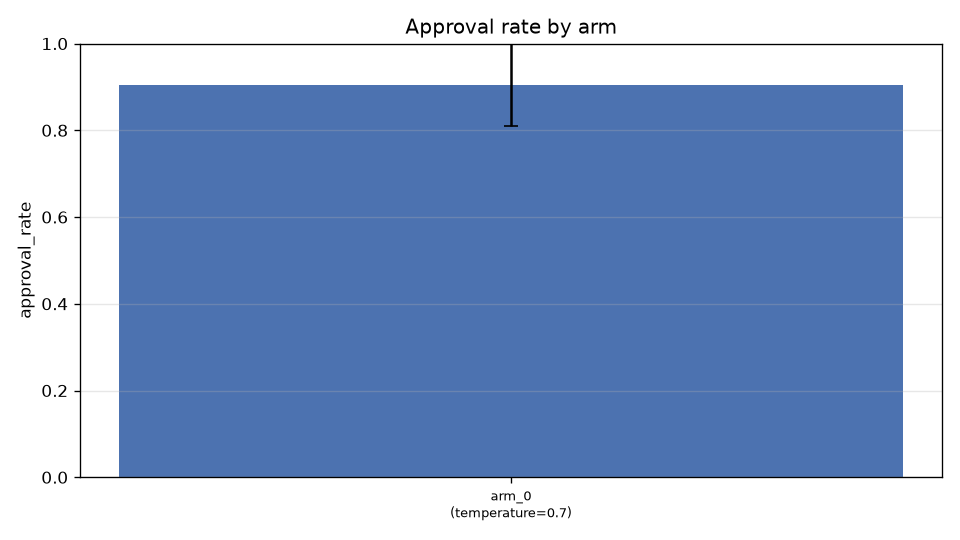
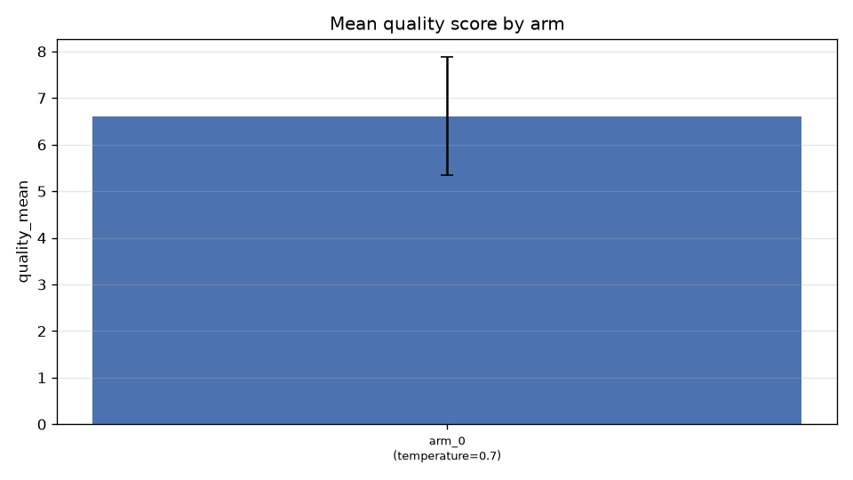
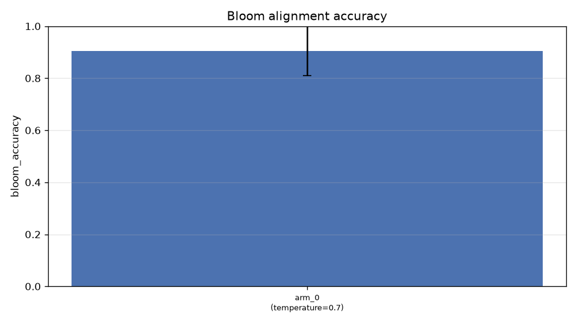

# E03 — Robustez entre clones (RESULTADOS REALES, extendido a 4 réplicas)

> 30 runs reales (1 brazo × 5 clones × 4 repeticiones: 10 de la campaña
> original + 20 de la extensión), GLM-5.3-Flash vía gateway USFQ. Config
> idéntica en todos los runs (temperatura 0.7, evaluador 0.2, top_k 3);
> material idéntico; solo cambia el nombre de la materia (Eva, María, Sofía,
> Lucía, Pablo). Los 30 runs terminaron `completed` con PDF compilado.

## Resultados

| Métrica | Media ± σ (30 runs) |
|---|---|
| Tasa de aprobación | 0.904 ± 0.10 |
| Quality score medio (attempts) | 6.61 ± 1.27 |
| Similitud por pares (diversidad) | 0.508 ± 0.03 |
| RAG retrieval score | 0.466 ± 0.004 |
| RAG faithfulness (léxica) | 0.291 ± 0.26 |
| Bloom accuracy | 0.904 ± 0.10 |
| Llamadas por ítem aprobado | 2.21 ± 0.27 |
| Tokens por ítem (estimado) | 2.166 ± 287 |

## Robustez entre clones (misma config, material idéntico)

Quality score medio por clon (4 runs cada uno): σ entre clones = **0.665**
(con 2 réplicas era 1.051; el estimador convergió al subir el tamaño
muestral). Por clon: Eva 6.36, María 6.11, Sofía 6.38, Lucía 7.93,
Pablo 6.27. Lucía es un outlier moderado (+1.3 sobre la media) pero dentro
del umbral global.

## Hallazgos

1. **H5 CONFIRMADA**: σ entre clones = 0.665 < 1.0 con 4 réplicas por clon
   (30 runs totales). El pipeline es estable frente a variaciones triviales
   del contexto (nombre de la materia): la varianza observada es la varianza
   estocástica pura del LLM a T=0.7, no sensibilidad al material.

2. **Aprobación alta y estable** (0.904 ± 0.10): el pipeline aprueba ~7.2 de
   8 ítems por run de forma consistente en 5 "profesores" distintos.

3. **Faithfulness RAG con alta varianza** (0.291 ± 0.26): algunos enunciados
   se apoyan fuertemente en el contexto recuperado, otros son más genéricos.
   El retrieval score es muy estable (0.466 ± 0.004): la variación viene del
   generador, no del recuperador.

4. **Diversidad estable**: similitud por pares 0.51 en todos los clones,
   muy por debajo del umbral de duplicados (0.82): el mecanismo anti-dup
   no se dispara en condiciones normales (valida H3).

5. **Coste consistente**: 2.2 llamadas/ítem y ~2.170 tokens/ítem con poca
   dispersión — el coste del pipeline es predecible.

## Judge LLM de faithfulness (post-hoc sobre los 30 runs)

Para complementar la métrica léxica, se ejecutó el judge LLM
(`analysis/judge_experiment.py`) sobre la campaña completa: 27/30 runs
juzgados (media global **0.352 ± 0.052**, escala 0-1):

| Métrica | Media ± σ | Lectura |
|---|---|---|
| Judge LLM (soporte factual) | **0.352 ± 0.052** | varianza BAJA entre runs |
| Overlap léxico (copia de tokens) | 0.309 ± 0.260 | varianza ALTA entre runs |

El judge es **más estable** (σ 5× menor) que el overlap léxico porque no
premia la copia literal: penaliza igual un enunciado sintetizado y uno
copiado si ambos están factualmente soportados. Confirma que la alta
varianza del faithfulness léxico era ruido de la aproximación, no del
pipeline. Configuración del judge: mismo modelo que el pipeline
(self-judge, GLM-5.3-Flash), T=0, `reasoning_effort=none`,
`max_tokens=2000` (el gateway consume tokens de reasoning incluso con
effort none; con 300 el JSON se cortaba).

## Nota metodológica

Los ítems y evaluaciones son idénticos entre clones hasta la semilla del
planner: la varianza observada es atribuible al LLM (muestreo estocástico
de temperatura 0.7), no al material. Con 4 réplicas por clon, σ entre clones
converge a la varianza pura del modelo (0.665).
