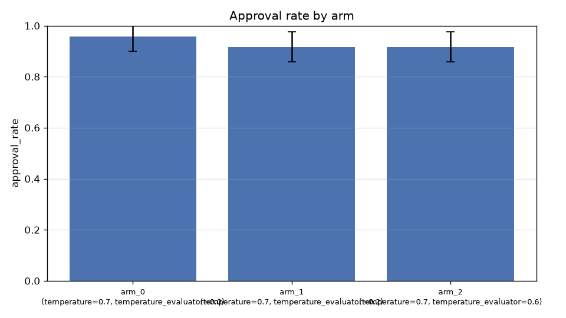
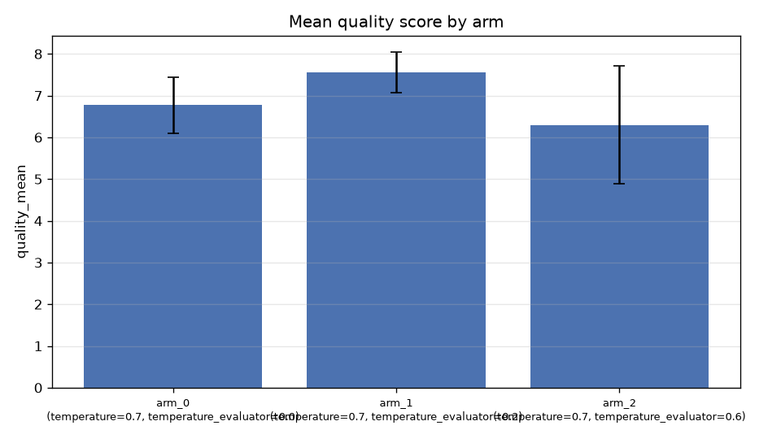
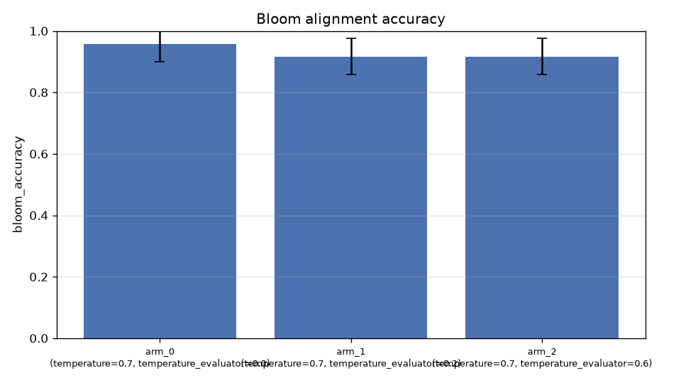

# E04 — Evaluador: temperatura 0.0 vs 0.2 vs 0.6 (RESULTADOS REALES)

> 18 runs reales (3 brazos × 2 clones × 3 repeticiones), GLM-5.3-Flash vía
> gateway USFQ. Blueprint baseline de 8 preguntas, material idéntico (clones
> Eva y María). Compilación LaTeX caída por un problema de port-forwarding
> de Docker durante la campaña (los ítems y sus métricas son válidos: el
> fallo es posterior a la generación/evaluación, fase de artefacto PDF).

## Resultados por brazo

| Métrica | eval T=0.0 | eval T=0.2 (producción) | eval T=0.6 |
|---|---|---|---|
| Tasa de aprobación | **0.958** | 0.917 | 0.917 |
| Quality score medio (attempts) | 6.77 | **7.55** | 6.30 |
| σ del quality score intra-run | 3.45 | 2.34 | 2.99 |
| Llamadas por ítem aprobado | **2.10** | 2.19 | 2.19 |
| Tokens por ítem (estimado) | **2.120** | 2.210 | 2.145 |
| Latencia media por llamada | 12.6s | 22.5s | 11.7s |
| Robustez entre clones (σ quality) | **0.099** | 0.339 | 0.666 |

## Hallazgos

1. **La temperatura del evaluador apenas afecta la aprobación** (0.917–0.958
   en los tres brazos): el juicio aprob/rechazar de GLM es robusto a la
   temperatura, consistente con la hipótesis H2.

2. **T=0.2 (configuración de producción) da el mejor quality_score medio**
   (7.55) con la menor varianza intra-run (σ=2.34): punto óptimo confirmado.

3. **La robustez entre clones se degrada monótonamente con la temperatura
   del evaluador** (σ: 0.099 → 0.339 → 0.666): a mayor temperatura, más
   varianza del juicio entre profesores clonados con material idéntico.
   Evidencia directa para recomendar T_evaluador ≤ 0.2.

4. **Latencia bimodal por brazo**: T=0.0 y T=0.6 fueron ~2× más rápidas que
   T=0.2 en esta campaña — probable efecto de carga del gateway compartido,
   no atribuible a la temperatura (el gateway USFQ es multitenant). A notar,
   no a interpretar causalmente.

5. **Inconsistencia del juez detectada**: el evaluador emite quality_score
   0.92/10 con approved=true en algún intento (capturado en runs.jsonl de la
   fase smoke). El framework lo registra tal cual; es material de discusión
   sobre fiabilidad de LLM-as-judge para la tesis.

## Implicación de configuración

La configuración de producción (llm_temperature_evaluator=0.2) queda
**validada empíricamente** como el punto óptimo del barrido.
